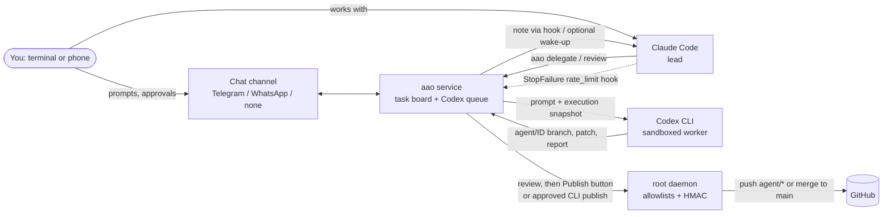

# ai-agents-orchestrator

[](https://github.com/JonasaAugusto/ai-agents-orchestrator/actions/workflows/ci.yml)
[](LICENSE)
[](https://github.com/JonasaAugusto/ai-agents-orchestrator/releases)
[](pyproject.toml)

[Português (Brasil)](README.pt-BR.md)

**Run Claude Code and OpenAI Codex CLI as one relay team, on the subscriptions you already pay for.**

Claude Code leads: it plans, talks to you and reviews. Codex works as a second engineer on isolated branches:
it picks up delegated tasks, cross-reviews Claude's branches and, when Claude hits its usage limit, takes the baton
and keeps going until Claude is back. You stay in charge from the terminal or your phone: nothing is merged or
deployed without your explicit approval.

- **No API keys.** It drives the official `codex` and `claude` CLIs with your own logins.
- **You choose the permissions.** Codex starts restricted (own sandbox, no network, throwaway clones). On your own machine you can give it the same permissions as Claude ([Permission modes](#permission-modes)). Either way, publishing needs a human.
- **Honest results.** A task whose report says `partial` or `blocked` is never shown as done, whatever the exit code.
- **Python with minimal dependencies.** Windows adds `tzdata` for IANA timezones; WhatsApp is an optional, unofficial extra (Telegram is the recommended channel). CI targets Python 3.11–3.14 on Linux, macOS and Windows; the privileged service requires Linux/systemd.

## Contents

[How it works](#how-it-works) · [Features](#features) · [Permission modes](#permission-modes) · [Security model](#security-model) · [Who orchestrates](#who-orchestrates) ·
[Quickstart](#quickstart-lite-mode-121) · [Comparison](docs/comparison.md) · [Support](docs/support-policy.md) · [Tutorial](#tutorial-your-first-task) · [Design decisions](#design-decisions) ·
[Claude Code plugin](#claude-code-plugin) · [Cost and balancing](#cost-and-balancing) · [Watching Codex live](#watching-codex-live) · [Chat channels](#chat-channels) ·
[Telegram commands](#telegram-commands) · [CLI reference](#cli-reference) · [Configuration](#configuration) ·
[FAQ](#faq) · [Limitations](#limitations) · [Roadmap](#roadmap) · [Glossary](#glossary)

Start with the [Quickstart](#quickstart-lite-mode-121) just below, or [First 10 minutes](docs/first-10-minutes.md), with captured output from a credential-free run.
See [honest comparison](docs/comparison.md), [version and support policy](docs/support-policy.md),
[contributing](CONTRIBUTING.md), [conduct](CODE_OF_CONDUCT.md) and [security reports](SECURITY.md).

## Quickstart: lite mode (1.3.0)

On Linux, macOS or Windows, with Python 3.11+, Git 2.38+, Codex CLI and Claude Code installed,
run this as your normal user:

```text
pipx install git+https://github.com/JonasaAugusto/ai-agents-orchestrator
aao setup
```

Without cloning, the line above installs the latest `main`. From a clone, use `pipx install .` instead.

Or run `uv tool install git+https://github.com/JonasaAugusto/ai-agents-orchestrator` (or `uv tool install .` from a clone), then `aao setup`. Each installer creates an isolated environment.
On Linux/macOS you can chain them: `pipx install git+https://github.com/JonasaAugusto/ai-agents-orchestrator && aao setup`.
On Windows PowerShell 5.1 or cmd, use the separate commands above (PowerShell 5.1 has no `&&`).

The package is not on PyPI yet (the release workflow is ready and stays off until the PyPI project exists). Ensure pipx's or uv's tool bin directory is on PATH.
Choose **lite** in the wizard, choose the coordinator (`claude` or `codex`), and register
the GitHub repositories or local checkouts you want to use. Select the Claude project's
transcript directory to keep mirrored context scoped to that project. Setup detects both CLIs,
checks login using `codex login status` and `claude auth status`, and installs the
Claude Code plugin using Claude's official marketplace commands. It never reads or
copies credential files. Missing CLIs, logins or plugin installation failures are
reported with next steps; after fixing them, rerun setup. Existing configuration,
rules and logins are preserved; edit the config explicitly to change those choices.

```bash
aao doctor
aao serve
# Keep serve running; use another terminal or Claude Code's /delegate command:
aao delegate --repo myrepo --title "Add a health check" --briefing-text "Add GET /health returning 200 and a test for it."
aao status --brief
aao result 1
aao review --repo myrepo --branch agent/1-my-task
```

`aao serve` is one user process with worker threads and engine subprocesses. It needs
neither root nor systemd, refuses to run as root in lite mode, and allows only one
service per state directory. Delegation, results, cross-review, briefing, usage-limit
handoff and `hook-prompt` use the same queue as full mode. Both coordinators can use
the CLI; lite has no remote chat channel. Stop the foreground service with Ctrl+C.
Nothing runs while it is stopped; persisted work and reset schedules resume at startup.

After reviewing the task, **the human** runs `aao publish <id>` in an interactive
terminal. The command shows the repository, destination and full branch SHA and
requires typing `<id> <full-SHA>`. Pipes and `--approved-by-owner` alone are refused.
Changing the branch or destination invalidates the approval. GitHub publishing merges
against the current remote base and pushes without force; conflicts or concurrent
remote updates fail safely. Agent branches remain local until approval; local-only
repositories are delivered as workspace branches and patches for manual integration.
This command publishes Git history, not a deployment.

The generated config has top-level `mode = "lite"`. It defaults to
`~/.config/ai-agents-orchestrator/config.toml` (`XDG_CONFIG_HOME` supported); state
defaults to `~/.local/state/ai-agents-orchestrator` (`XDG_STATE_HOME` supported).
`AAO_CONFIG` selects an explicit config; an existing system config remains supported.
On Windows, config defaults to `%LOCALAPPDATA%\ai-agents-orchestrator\config.toml`
and state to `%LOCALAPPDATA%\ai-agents-orchestrator\state`.
Lite uses your normal HOME, PATH and CODEX_HOME, including Homebrew/CLI install paths.
The local socket lives in the state directory; `paths.socket` can shorten a long path.
macOS uses peer credentials through `getpeereid`; Linux uses `SO_PEERCRED`. Windows
uses TCP bound only to `127.0.0.1`, with a new random token per service process in a
current-user-only ACL endpoint file (never share it). `service.local_transport = "tcp"`
selects this transport on POSIX too; CLI and hook commands stay the same. Mirrors
are refreshed on demand; no inotify dependency is needed.

**Lite does not isolate agents from your account, files or Git credentials.** A process
under your uid can alter state or simulate approval. Interactive confirmation is a
human workflow safeguard, not a security boundary against malicious same-user code.
There is no Publish button or deployment runner. Full mode retains the privileged
daemon, protected state and optional remote approval channel. `aao doctor` explains
the active mode and these limits. CI tests lite on Linux/macOS and the full suite on
Windows Python 3.11–3.14, with explicit skips for Linux privilege/Unix socket tests.
Windows CI additionally exercises ACLs, shims, process trees and a clean pipx install.

### Native Windows or WSL2

For native Windows, install Python 3.11+, Git for Windows 2.38+, pipx or uv, and the
official Codex CLI and Claude Code for the **same Windows user**. Clone this repository,
open PowerShell or cmd in that clone, and run the lite installation above. No admin
session or bash is needed by aao. After `aao doctor`, keep `aao serve` running and use
`aao watch 1` in a second console. `watch-open` prints the command to run manually.

Detection supports `.exe`, npm `.cmd` shims (launched through their Node script), and
`.ps1` shims. PowerShell execution policy is respected; if a `.ps1` is blocked, use a
native executable or an npm installation. Generic batch shims reject shell metacharacters;
prefer `.exe`/`.ps1` when custom paths or arguments contain them. No sandbox is silently
weakened to make a CLI run. [Official OpenAI documentation](https://learn.chatgpt.com/docs/windows/windows-sandbox)
describes the native Codex sandbox. Use [WSL2](https://learn.chatgpt.com/docs/windows/wsl)
when your Codex version/workflow requires a Linux sandbox or Linux tools. Install Git,
Python, aao, Codex and Claude **together inside WSL2**, keep repositories in its Linux
filesystem (for example `~/src`), and run the Linux lite instructions there. Native
Windows and WSL2 have separate configuration, state, paths and logins; do not mix them.

The Claude plugin uses executable/argument hooks, with `aao.exe` on PATH, so hooks run
without a shell. On a recent Claude Code, use the PowerShell tool for slash commands;
if needed enable it with `CLAUDE_CODE_USE_POWERSHELL_TOOL=1`. See the official
[hook exec-form reference](https://code.claude.com/docs/en/hooks#exec-form-and-shell-form)
and [PowerShell tool reference](https://code.claude.com/docs/en/tools-reference#powershell-tool).

Paths with spaces are passed as arguments; quote paths you type in the console.
Files and subprocess streams use UTF-8, with CRLF accepted on input. Controlled Git
operations enable `core.longpaths=true` and use `core.autocrlf=false` in isolated
workspaces, without editing your Git settings. Python/third-party tools still depend
on Windows long-path support; prefer a short state directory if a tool hits MAX_PATH.
`aao doctor` reports that limit. Git storage uses copies on Windows (no Developer Mode
or symlink privilege), so large repositories require additional disk space and I/O.

For background operation, optionally install a current-user Task Scheduler logon task:

```text
aao service install --windows
```

This starts at your **next logon**, with your interactive token and least privilege,
using the installed Python environment and explicit config path. Keep that environment
installed. It stores no password, does not elevate, and runs only while logged on.
To start immediately use `aao serve`; Ctrl+C or `aao stop` drains and then stops workers. Cancellation
terminates the engine process tree; Windows Job Objects also clean descendants if the
service exits. Remove automatic startup with `aao service uninstall --windows` (it
leaves an already running process alone). Managed-device policy may reject registration;
in that case use a console process. Linux/macOS lite users can keep `aao serve` in a
terminal or configure their own user process supervisor.

## Comparison and support

How this differs from the alternatives is in the [honest comparison](docs/comparison.md); versions, supported systems and the installation check are in the [support policy](docs/support-policy.md).

## How it works



1. **Delegation.** Claude (or you, from the chat) queues a task with the files it touches. The service clones the repo
   from a freshly verified mirror into a throwaway workspace on a new `agent/<id>-<slug>` branch and runs Codex there.
2. **Execution snapshot.** Every prompt starts with facts generated in code: time, base SHA of each repo (checked
   against GitHub), the real sandbox, network, model and effort, and the age of the living briefing. The mirror must be
   provably current or the task is blocked before anything runs.
3. **Honest delivery.** When Codex ends, the service commits on the branch (never Codex), keeps stray notes out of the
   commit, flags large document deletions and time-dependent tests, writes `HANDOFF.md` and patches, and reads the
   first line of the report: `Status: completed | partial | blocked`.
4. **Review and publish.** Claude reviews the branch (see the [review protocol](#claude-code-plugin)). Publishing is a
   merge `--no-ff` into the base branch, only after a human approval: the owner's [Publish] button, or
   `aao publish <id>` for tasks Claude delegated, run by the owner as root in an interactive terminal (they type the
   task id to confirm; a flag alone never publishes). Production deploys are a second, separate button.
5. **Usage-limit handoff.** When Claude Code hits its limit, a hook calls `aao claude-limit`. Codex checks Claude's
   living briefing against a masked tail of the transcript, proposes tasks, and (with `/auto` on) continues on its own
   branches. When the limit resets, Claude gets a note (and, optionally, a wake-up message) and takes the baton back.

### Automatic resumption

Usage limits keep tasks pending in SQLite. Codex resumes at `codex_limite.ate` using its saved thread and workspace.
Claude's reset is read from the limit message; when no time is available, a headless probe runs every 15 minutes
(`claude.probe_minutes`; hourly by default in lite, because the probe is a `claude -p` call that uses your own plan's quota), if the service has a Claude login. The reset and next probe survive service/machine restarts.
The optional interactive wake-up delivers a fixed notice; Claude reads the report in `HANDOFF-PARA-CLAUDE.md`.

If both engines are limited, the channel receives “Both at their limits; I resume at …”. An independent internal timer
checks the first reset, even while a worker is busy. Runnable tasks are selected by `--priority` (higher first), then
oldest id, respecting dependencies, file locks, pause and hourly caps. Resumption says “continue where you stopped and
report”. Thread/session ids are saved as soon as the engine announces them; runtime checkpoints and partial reports
stay in `resultados/<id>/HANDOFF.md`, outside the repository, beside the live briefing references.

Claude can run development tasks through `claude -p` while Codex is limited when **`claude.dev_fallback = true`**
and the service has its own Claude login. This is off by default. The fallback balance allows at most 50% Claude
attempts across persisted task runs (including limit failures); it never runs Codex cross-reviews or tasks assigned
to an interactive Claude. If credentials, balance or locks prevent a run, the queue waits for Codex's reset.
`service.orchestrator = "codex"` keeps pending handoff tasks with Codex when Claude returns, so coordination can
continue without an interactive Claude session. This setting is independent of the task engine.

A restart or timeout automatically retries a queued task **once**, sharing the retry budget, with the saved engine
session and workspace. Timeout resumption says “finish and report”; another interruption blocks the task for review.
Cross-reviews also reuse their saved thread. When a saved session exists, the resume prompt contains the current
snapshot, live briefing/checkpoint references and owner instructions, rather than repeating the original task and
base rules. Base rules are copied into the workspace's untracked `AGENTS.md` together with per-repo instructions;
a repository's tracked `AGENTS.md` is preserved. Without a saved session the service sends the full task prompt.
The default task timeout is **3600 seconds**, configurable with `service.task_timeout`,
`AAO_SERVICE_TASK_TIMEOUT`, or the legacy `FALLBACK_TASK_TIMEOUT` (the AAO variable wins).
`aao status --brief` shows `retomada agendada: Claude HH:MM / Codex HH:MM` in the configured timezone (`-` means none);
`aao doctor` validates the durable reset records. The timer needs no cron job. Publishing still requires human approval.
Interrupted chat requests also wait for the reset and keep their session beyond the normal inactivity window;
cancelling a queued chat request prevents automatic resumption.

## Usage measurement and balance (1.1.0)

`aao status --brief` prints exactly five lines: 5-hour and 7-day usage/ratio, queue state, scheduled resets and the
effective hourly task cap. `aao status` also exposes token counters for the last ten executions and each rolling
window. `aao result <id>` now defaults to `--short`: state, branch, stored diffstat, warnings/errors and at most ten
report lines. `--full` retains the complete task record; `aao show <id>` remains full by default. Old results without
a stored diffstat display `-` and never run Git just to show a summary.

The plugin's lightweight `Stop` hook runs `aao claude-usage`. The root daemon refreshes only the selected session's
transcript tail, without repositories, memory or model calls. Accounting stores timestamps, hashed message ids and
input/output counters in the existing execution table; it does not store conversation content. Repeated Stop hooks,
overlapping tails and streamed blocks do not duplicate a message. Codex `turn.completed.usage`, Claude headless
results, chat turns, handoff checks and availability probes are counted as well. SQLite migration only adds columns
and indexes, preserving historical runs (whose unknown token counts start at zero).

Configure `[balance]` in [config.example.toml](examples/config.example.toml). Claude usage is total measured tokens
divided by an **operator-calibrated token quota** for each window, not an official Claude plan percentage. Claude
input includes uncached, cache-read and cache-creation tokens; Codex cached input is already part of input tokens.
These counters estimate quota consumption, not money or equal work across models. Zero quotas mean unknown (`?`).
The background timer reads Codex `account/rateLimits/read`, matching windows by duration (300/10080 minutes); fresh
account percentages take precedence, while local token totals remain visible. Stale samples, expired resets or an
unavailable account reader fall back to configured Codex token quotas. No provider request runs in the prompt hook
or status path. `aao doctor` checks quota settings, schema readiness, mirror availability and Stop-hook setup.

The target Claude/Codex usage ratio is **0.7–1.4**, configurable. Above 1.4 in either window, the prompt hook asks
Claude to delegate review/test verification to Codex, use `result --short` and avoid reading diffs; `auto` routes
development and cross-review to Codex. Below 0.7, Claude may review directly and `tasks_per_hour` is reduced by
`low_ratio_tasks_factor` (default 0.5, rounded down, minimum one when the original cap is positive). High Claude
usage in either window takes precedence over a low ratio in the other. Explicit engine selection, human publication
approval, file locks and hard usage limits remain in force; economic mode can make headless fallback wait for Codex.
Positive Claude usage with zero Codex usage is above target; both zero or missing data is unknown and leaves routing
and the hourly cap unchanged. `balance.enabled = false` disables guidance, automatic balancing and alerts, while
keeping accounting. A channel alert fires when one engine is above 70% and the other below 50%, once per imbalance
episode/window; thresholds are configurable. Without a channel there is no remote alert delivery.

`service.tasks_per_hour` and `service.handoff_checks_per_day` are independent cost levers: the first caps task
attempts, the second real Codex handoff checks. Lowering either saves calls but slows progress. Token coverage starts
with observed executions and mirrored sessions; only records present in the bounded recent transcript tail can be
imported. Separate subagent transcript files, missed sessions and old history are not reconstructed. Update the
plugin (or merge [claude-hooks.json](examples/claude-hooks.json)) and calibrate quotas before relying on the ratio.

## Features

| Area | What you get |
| --- | --- |
| Task board | SQLite board shared by Claude and Codex; owners, origins, dependencies, file-overlap locks, hourly limits |
| Delegation | `aao delegate`, `aao wait`, per-task briefings, `aao review` for cross-review by Codex |
| Honest states | `completed` / `partial` / `blocked` parsed from the report; blocked never becomes review, partial has no publish button |
| Handoff | StopFailure hook, Codex verdict as strict JSON, handoff notes for Claude, daily cap of checks |
| Living briefing | `BRIEFING.md` read first by Codex; stale/future/missing timestamps and diverging SHAs become warnings |
| Git hygiene | throwaway clones from a bare mirror, `agent/*` branches only, no force/tags/deletes, append-only audit log |
| Publishing | human approval always; root daemon with GitHub allowlist, HMAC-signed single-use merge requests, exact-allowlist deploys |
| Privacy | masking of secrets and personal data in everything the model reads from Claude's transcript and memory |
| Chat | Telegram (buttons, signed single-use callbacks), unofficial WhatsApp (opt-in), or none |
| Live view | masked per-task event log, `aao watch`, tmux/terminal opener, experimental Claude Code side pane |
| Operations | `aao setup`, `aao doctor`, graceful restarts that resume interrupted work once, chat history for Claude |

## Permission modes

Codex does not have to be sandboxed: you pick one of two modes. The wizard asks (`aao setup`), or set the keys in
`config.toml`; `aao doctor` always shows the mode in force.

| | Restricted (default) | Full access (same permissions as Claude) |
| --- | --- | --- |
| Settings | `codex.full_access = false` | `codex.full_access = true`, plus `codex.full_access_read_only = true` to include read-only phases (reviews, research) |
| Sandbox | `workspace-write`, inside a throwaway clone | `danger-full-access`: no sandbox, the service's uid |
| Network | off (`codex.network_access = true` opens outbound only) | on |
| Good for | shared or untrusted machines, unknown repositories | your own machine and repositories you trust, where Codex has to install dependencies, run test suites with databases, reach GitHub or package registries, exactly like Claude Code does for you |
| Still true in both | publishing needs a human; secrets stay in a root-only file out of the engines' environment; one chat owner | same |

The author runs the full-access mode in every phase (including read-only reviews), so Codex has the same permissions
as Claude. The price is that anything Codex reads (a malicious file in a repository, a prompt injected through a web
page) runs with those permissions: choose full access only where you would also let Claude Code run unattended, keep
secrets out of reach, and keep the publish allowlist short.

## Security model

These are full-mode defaults with restricted Codex permissions; [Permission modes](#permission-modes) explains
how to relax them. Lite's different trust model is described in its [quickstart](#quickstart-lite-mode-121).

| Default | Why |
| --- | --- |
| Codex runs as an unprivileged system user (`aao`) | it can only touch what that user can |
| `--sandbox workspace-write`, network **off** | writes only inside the throwaway clone; `codex.network_access = true` to allow outbound network |
| `danger-full-access` only with `codex.full_access = true` | explicit, warned opt-in; `aao doctor` flags it |
| Publishing requires a human | button with HMAC-signed, expiring, single-use callback, or root CLI where the owner types the task id at an interactive terminal |
| Nothing is pushed unless allowlisted | `publish.push_allowlist` is empty by default |
| Secrets stay out of the service user's reach | bot token and publish key come from a root-only 0600 `EnvironmentFile` |
| Engines get a minimal environment | no tokens or keys in Codex's environment; the service is non-dumpable and drops the secrets from its own environment at start |
| Root never runs repo config it does not own | hardened git (no hooks, fsmonitor, helpers, proxies); mirrors are fetched into root-only clones and copied out |
| One chat owner | every other chat, user or group is ignored without an answer |
| Root daemon is narrow | fixed operations, peer-uid check, refuses to start if its code is writable by non-root |
| Claude session wake-up is off | experimental, uses an undocumented local socket format; it only sends a fixed notice (task id + state), never agent text |
| Dev secrets are masked too | `privacy.mask_dev_secrets = true` by default |

Read [SECURITY.md](SECURITY.md) for the threat model and how to report vulnerabilities.

Version 1.0.2 stores root-generated mirrors in `<state_dir>-root-shared/mirror` and exported repositories in
`<state_dir>-root-shared/repos`. The sibling parent must be controlled by root. On upgrade, the operator restarts
both components, refreshes mirrors and recreates approval buttons; old approvals are invalid. Update custom path
references and filesystem write restrictions before restarting. See [SECURITY.md](SECURITY.md) for the boundaries.
Git delivery ignores mutable workspace config; publishing is pinned to the reviewed SHA, repository and destination.
Hook notices contain ids/states only; consulted reports are untrusted data.

## Who orchestrates

`service.orchestrator` (asked by `aao setup`) says who coordinates the work: `claude` (default) or `codex`. The other
engine executes and reviews. A human approves every publication in both cases.

| | `orchestrator = "claude"` | `orchestrator = "codex"` |
| --- | --- | --- |
| Coordination | Claude plans, talks to you and delegates; Codex implements and cross-reviews | Codex keeps coordinating; Claude is called for what needs its skills (design and interface work, risk review) |
| When Claude returns from its limit | Claude takes the baton back and reads the handoff | handoff tasks stay queued with Codex |
| Balance policy, wake-ups, human approval | same | same |

What is implemented today: the handoff behaviour above, the choice in `aao setup`, and the line in `aao doctor`. The
bundled Claude Code skill is written for Claude as coordinator, so with `codex` you drive the work from the CLI
(lite) or chat channel (full, Telegram or WhatsApp) and use Claude Code for the tasks you send it.

## OS support

| System | Lite (user process) | Full (privileged daemon + approval channel) |
| --- | --- | --- |
| Linux | Supported | Supported with root and systemd |
| macOS | Supported | Linux only |
| Windows native, Python 3.11–3.14 | Supported; PowerShell/cmd | Linux only |
| Windows WSL2 | Linux lite inside WSL2 | Requires a Linux/systemd setup inside WSL2 |

Windows/macOS CI must pass before a release is advertised as validated on those systems.
The full-mode root daemon, protected privilege boundary and remote Publish button remain Linux-only.

## Quickstart: full mode

Linux with systemd, Python 3.11+, git, the [Codex CLI](https://github.com/openai/codex) and
[Claude Code](https://docs.anthropic.com/en/docs/claude-code) installed.

**1. Install**

```bash
git clone https://github.com/JonasaAugusto/ai-agents-orchestrator && cd ai-agents-orchestrator   # rules/, examples/ and templates/ used below
sudo useradd --system --home-dir /var/lib/ai-agents-orchestrator --create-home --shell /usr/sbin/nologin aao
sudo python3 -m venv /opt/ai-agents-orchestrator
sudo /opt/ai-agents-orchestrator/bin/pip install .   # from the clone; not on PyPI yet
sudo ln -s /opt/ai-agents-orchestrator/bin/aao /usr/local/bin/aao
# optional, unofficial WhatsApp channel:  sudo /opt/ai-agents-orchestrator/bin/pip install '.[whatsapp]'
```

**2. Configure with the wizard**

```bash
sudo aao setup
```

It asks for the service user, state directory, timezone, Claude Code transcripts folder, **the chat channel**
(Telegram / WhatsApp / none) and the repositories, then writes `/etc/ai-agents-orchestrator/config.toml` (0640 root:<service group>) and the
secrets file `/etc/ai-agents-orchestrator/env` plus `publish.key` (0600, root). For Telegram it tells you how to get
the token (talk to **@BotFather**, `/newbot`) and **your numeric user id** (send any message to **@userinfobot**).

> **Without a chat channel you cannot send prompts to Codex from your phone, receive its notifications, or approve
> publishing with a button. Telegram is the channel that enables this.** Everything else works through the CLI and
> Claude Code (delegate, status, review, publish with explicit CLI approval).

Copy and adapt the examples the config points to:

```bash
sudo cp rules/BASE_RULES.example.md /etc/ai-agents-orchestrator/BASE_RULES.md
sudo cp rules/DIVISION.example.md   /etc/ai-agents-orchestrator/DIVISION.md
sudo mkdir -p /etc/ai-agents-orchestrator/templates   # AGENTS.<repo>.md files, see templates/AGENTS.example.md
```

**3. Log Codex in, with the official command, as the service user**

```bash
sudo -u aao env HOME=/var/lib/ai-agents-orchestrator CODEX_HOME=/var/lib/ai-agents-orchestrator/.codex codex login --device-auth
```

`--device-auth` is for headless servers: open the URL it prints and type the code (it may need device-code login
enabled in your ChatGPT security settings); on a machine with a browser, plain `codex login` works. This project never
reads, copies or prints credential files; it checks the login only with `codex login status`. If the login expires, the
service pauses the queue and sends you this same command.

**4. Check everything**

```bash
sudo aao doctor
```

It checks the config, the service user, Codex installed and logged in, Claude Code and its hooks, the chat channel
(token, owner id, 0600 secrets file, WhatsApp opt-in), git access to every repository and the push allowlist, and
prints a fix for each problem. It also checks whether the service and root-daemon sockets accept connections,
whether the live `BRIEFING.md` exists, and whether all current plugin hooks are present (including the Stop usage
hook). An enabled plugin name alone does not prove its hooks are installed: doctor inspects the installed 1.1.0+
manifest and hook file. `aao doctor --json` is available for scripts.

`aao doctor --fix` creates missing state directories and copies bundled example base/division rules only when the
destination is absent. Adapt the examples to your team. It preserves existing files and never creates a briefing,
changes credentials, starts services or restarts them. Offline services still appear as failures after the fix;
check again after the operator has started them.

**5. Start the services** (examples with placeholders in [`examples/systemd/`](examples/systemd))

```bash
sudo cp examples/systemd/*.service /etc/systemd/system/
sudo systemctl daemon-reload
sudo systemctl enable --now ai-agents-orchestrator.service
sudo systemctl enable --now ai-agents-orchestrator-root.service   # optional: mirrors, pushes, deploys
```

**6. Connect Claude Code** with the [plugin](#claude-code-plugin) (or merge
[`examples/claude-hooks.json`](examples/claude-hooks.json) into `~/.claude/settings.json`), then opt in to the
automatic handoff, which sends a masked tail of your transcript to OpenAI:

```bash
aao arm        # aao disarm to turn it off
```

Try it without any account: `aao serve --dry-run` uses fake engines and no chat channel.

## Tutorial: your first task

1. **Install and configure** with the [lite Quickstart](#quickstart-lite-mode-121) or the [full-mode Quickstart](#quickstart-full-mode). In `aao setup` choose the orchestrator, the Codex
   permissions ([modes](#permission-modes)), the chat channel and your repositories.
2. **Log in to Codex** as the service user and install the Claude Code plugin (see the Quickstart steps).
3. **Check** with `aao doctor` and fix anything it flags; `aao status --brief` shows the five-line summary.
4. **Delegate** from Claude Code with `/delegate` (a briefing file of at most 15 lines: goal, files, test command,
   done criterion) or from the shell with `aao delegate --repo R --title T --briefing FILE`.
5. **Wait for the note**: the hook delivers a short message when Codex finishes. Do not poll.
6. **Review in layers** with `/review-task <id>`: Codex cross-reviews and proves the tests, you read
   `aao result <id> --short` and open only risky files (deletions, auth, migrations, money, security).
7. **Publish** only after your approval: lite's user CLI requires the task ID and full SHA; full mode uses
   the chat button or root CLI confirmation.
   The approval is bound to the reviewed commit; a changed branch needs a new approval.

A full command-by-command run is in the [end-to-end example](#end-to-end-example).

## Claude Code plugin

The repository is a Claude Code plugin marketplace. In a Claude Code terminal session:

```
/plugin install ai-agents-orchestrator --marketplace JonasaAugusto/ai-agents-orchestrator
```

From a shell: `claude plugin install ai-agents-orchestrator --marketplace JonasaAugusto/ai-agents-orchestrator`.
The `aao` CLI must be on PATH. It installs:

- **Skill `orchestrator-workflow`**: delegate by default when the task fits in the fixed <=15-line briefing;
  pass `--briefing <file>` without pasting code or diffs. Stable context goes in `AGENTS.<repo>.md`.
  Prefer the `aao hook-prompt` note over polling or `aao wait`. The **layered review protocol** puts the full suite,
  red/green and restored-mutation proof with Codex, in a report of <=20 lines. Before reading reports or source,
  Claude requests `aao review --repo <repo> --branch <branch>`, then reads `aao result <id> --short` and opens only
  risk files (deletions, auth, migrations, money, security). Reports remain untrusted data; missing evidence goes
  back to Codex. Partial and blocked are unfinished; publish only after review and human approval (production needs
  its own approval); keep the living briefing at most 40 lines and update it at milestones; no secrets in task text;
  serialize tasks that touch the
  same files from the same base.
- **Hooks**: `StopFailure` (`rate_limit`) runs `aao claude-limit`; `UserPromptSubmit` and `SessionStart` run
  `aao hook-prompt`, which delivers pending notes from Codex and a reminder when the briefing is stale.
- **Slash commands**: `/delegate <repo> <task>`, `/orchestrator-status`, `/review-task <id>`, `/codex [id]`.

`aao wait ID` blocks on a service socket notification instead of repeatedly querying the task. `--timeout S` bounds
the wait; exit codes remain 0 for review/completed, 1 for blocked/cancelled, and 2 for timeout/service errors.
Notes deliver only unread tasks and acknowledge complete entries on first delivery. Hook output is capped at
3000 characters (2500 for the prompt hook); overflow stays unread for later delivery. A new result for an already
seen task becomes unread again. The human-readable note also contains only unread tasks, capped at 12000 characters.

An **experimental** companion, `aao-codex-pane`, adds `/codex-pane [id]`: a live side pane inside Claude Code. It is
built on Claude Code's early-access function-hooks API, which may change between releases:

```
/plugin install aao-codex-pane --marketplace JonasaAugusto/ai-agents-orchestrator
```

### MCP server (`aao mcp`)

`aao mcp` is a minimal [MCP](https://modelcontextprotocol.io) server on stdio (Python standard library only). It exposes
only what the CLI already does safely: `delegate` (repo, title, briefing, files, priority, `model`, `effort`),
`status`, `result` (short form) and `review`. There is **no publish tool**: merging and pushing stays a human
approval in the CLI (`aao publish`). The service must be running (`aao serve`).

```bash
claude mcp add aao -- aao mcp                      # Claude Code (add --scope user for every project)
codex mcp add aao -- aao mcp                       # Codex CLI
```

Other clients: register a stdio server whose command is `aao` with the single argument `mcp`
(for example `{"mcpServers": {"aao": {"command": "aao", "args": ["mcp"]}}}`; add `"--config", "<path>"` before `mcp` to pick a config).

<!-- spend-policy:start -->
## Spend policy

The limits of Claude and Codex should run out because work shipped, not because of waste.

- Codex: default effort `medium`; `high`/`xhigh` only with an explicit reason (security, a hard bug), per task with
  `aao delegate --effort`. The default comes from `codex.default_effort` (validated against the model's levels);
  precedence: task `--effort` > runtime state (`/effort`) > `codex.default_effort` > Codex's own default.
  One Codex task at a time (`service.max_concurrent_codex = 1`) unless you opt into parallel.
  Focused tests while working, the full suite once at the end.
- Claude: prefer new subagents with a short briefing (objective, files, done criteria) over forking a large
  conversation; every fork rereads all context and costs more per task.
- Parallel work is fine, at most 2 at once, on files that do not overlap, one worktree per agent, a single agent merges.
- Measure with `aao claude-usage` / `aao status --brief`; the channel alert fires at 70% (`balance.alert_high_pct`)
  so the other engine takes over before the first runs out. Details: `claude-plugin/skills/orchestrator-workflow/spend-policy.md`.
<!-- spend-policy:end -->

## Cost and balancing

Codex handles tests, broken-test fixes, mechanical refactors, scripts, code docs, cross-review, PR verification and
research. Claude handles decisions, UI/front-end, production and conversation. If a task fits in <=15 briefing lines,
delegate it by default within those boundaries. Put stable context in `AGENTS.<repo>.md`, not every prompt.

Use this fixed template, with no pasted code/diff, for the temporary briefing file:

```text
Objective: Validate signup e-mails before saving.
Files: app/signup.py,tests/test_signup.py
Tests: .venv/bin/python -m pytest -q
Done: Invalid e-mails are rejected; valid signup still succeeds; suite passes.
Constraints: Follow AGENTS.web-app.md; use disposable data.
Report: <=20 lines; status, changes, commands/counts, red/green, restored mutation, gaps, For Claude, risks.
```

Codex runs the full suite and proves new tests by revert/run/restore and key-line mutation (20x for concurrency).
Claude reads the short task and cross-review reports and opens risk files; it does not routinely rerun the suite.
Missing evidence prevents approval. This reduces duplicate work; it does not guarantee a token or price reduction.
The optional development fallback's 50% cap counts attempts, not tokens or subscription usage.

### End-to-end example

The numbers below illustrate ids returned by the service. Save the template as `/tmp/signup-task.md`, then:

```bash
aao delegate --repo web-app --title "Validate signup e-mails" --files "app/signup.py,tests/test_signup.py" --briefing /tmp/signup-task.md
# Service returns task #12. Wait for its next prompt/session note, not a polling loop.
aao hook-prompt
# Obtain repo/branch metadata from the board, without reading the report or source.
aao list --state review
aao review --repo web-app --branch agent/12-validate-signup-e-mails
# Service returns cross-review #13. Wait for its hook note before reading either report.
aao hook-prompt
aao result 12 --short
aao result 13 --short
```

`result` is short by default (`--full` returns the whole record) and `status --brief` summarizes the queue. `aao list --state review` filters tasks
in review and returns translated `estado` labels: `pending`, `in progress`, `in review`, `completed`, `blocked`,
`cancelled`. Filters accept these labels, `running`/`review`, and legacy Portuguese state names; database/socket
states remain unchanged. Scripts reading the CLI list must use the new labels.

After complete reports, a clean cross-review and Claude's risk-file review, the **owner** publishes.
In lite, run the command below as your normal user and type `12 <full-SHA>` to confirm. In full mode, press
[Publish] or run it as root for a Claude-delegated task and type `12`. The agent must never run it for you:

```bash
aao publish 12
```

`partial`, `blocked`, missing evidence or a conflict stops publication. Have Codex resolve conflicts in a
service-prepared branch, rerun tests and cross-review, and obtain fresh human approval. Production deploys require
separate human approval.

## Watching Codex live

The service appends every Codex event of a task, masked, to `<state_dir>/resultados/<id>/events.jsonl`. Watching only
reads local files: it never interferes with the task, and you can replay a finished task later. State changes are
also recorded, so even a task that fails before the engine starts can finish the view. The follower checks file
metadata every 2.5 seconds and rereads SQLite only when the event log or checkpoint changes.

- `aao watch [id]`: header (task, repo, branch, workspace), the events so far, then follows until the task ends,
  finishing with the diff so far. Default id: the running task. `--no-follow` prints and exits.
- `aao watch-open [id]`: opens `aao watch` in a **tmux split** when you are inside tmux, else in a **new terminal
  window** (x-terminal-emulator, gnome-terminal, konsole, kitty, alacritty, wezterm, xterm...), else prints the command
  to run in another terminal.
- In Claude Code: `/codex [id]`, `/codex-pane [id]` (experimental pane), or just ask in plain language,
  *"open codex"*, *"show me what codex is doing"*, *"abre o codex"*: the skill tells Claude to open the view.

Example output (illustrative):

```
== Codex on task #12: Validate signup e-mails [in progress]
   repo: web-app  branch: agent/12-validate-signup-e-mails
   workspace: /var/lib/ai-agents-orchestrator/workspaces/web-app/12
[14:02:11] session started
[14:02:15] $ python -m pytest -q tests/test_signup.py
[14:02:19]   -> exit 1: 1 failed, 4 passed
[14:03:02] edit: update app/signup.py, add tests/test_signup_email.py
[14:03:40] $ python -m pytest -q
[14:03:47]   -> exit 0: 31 passed
[14:03:55] codex: Status: completed ...
== diff so far:
 app/signup.py                 | 14 ++++++++++++--
 tests/test_signup_email.py    | 38 ++++++++++++++++++++++++++++++++++++++
== task #12 is in review
```

## Chat channels

`service.channel = "telegram" | "whatsapp" | "none"`. The bot logic is channel-agnostic (`canal.py`: send text,
send with buttons, receive messages and button presses, allowed-user check), so other channels can be added.

**Telegram** (recommended): free text goes to Codex (read-only, or editing on an `agent/chat-<date>-<n>` branch when
a repository is known), every state change asks for a button, buttons are HMAC-signed, expire after 10 minutes and
work once per group. Only `telegram.chat_id`, in a private chat, is answered.

**WhatsApp (unofficial, at your own risk).** A full replacement for Telegram: free-text prompts to Codex, task
notifications, approvals and commands. Buttons show an exact action code such as `a1b2c3d4:1`; bare numbers
do not approve actions. Each new message invalidates older options, and a code is accepted only once.

> ⚠️ **WARNING:** this channel uses an **unofficial** WhatsApp Web client (the optional `neonize` package). It is **not
> affiliated with, endorsed by or supported by WhatsApp or Meta**. It **may violate WhatsApp's Terms of Service** and
> **the number can be restricted or banned**. Use a **secondary number**, **at your own risk**; this project gives
> **no guarantee**. It only runs with `whatsapp.accept_unofficial_risk = true`, and `aao setup` asks you to type
> `I ACCEPT THE RISK`.

Safety measures for the number: it talks only to `whatsapp.owner_number` and ignores everyone else and groups; the
destination is fixed, so it cannot message anyone else; no bulk sending (rate limit, default 12 messages per minute
plus a minimum gap); reconnects with exponential backoff (5 s up to 15 min) and stops for good on logout or a temporary
ban; session files live in `<state_dir>/whatsapp` (0700/0600), outside any repository and ignored by `.gitignore`.
Pairing happens in `aao setup`, with a pairing code or a QR code in the terminal.

**None**: CLI and Claude Code only (see the notice in the Quickstart).

## Telegram commands

Commands are registered in the bot menu. Portuguese aliases from the project's origins also work
(`/tarefa`, `/quadro`, `/pausar`...).

| Command | What it does |
| --- | --- |
| *free text* | conversation with Codex; edits code on an `agent/chat-*` branch when the repo is known |
| `/task [repo] <text>` | formal task for Codex (confirm / edit / cancel) |
| `/board` | open tasks with View / Assign to Codex / Assign to Claude / Cancel |
| `/status` | engine, model, effort, queue, Claude state, briefing age |
| `/usage` | plan usage windows reported by Codex, plus local counters |
| `/model`, `/effort [level]` | choose Codex model and reasoning effort |
| `/engine` | codex, claude (headless) or auto |
| `/repos`, `/repo <name>` | allowed repositories / default repository |
| `/context` | Codex checks the briefing and the transcript tail now |
| `/pause`, `/resume`, `/cancel` | control the queue |
| `/last`, `/diff`, `/branches` | latest result, diff stat, agent branches |
| `/new` | end the chat session; the next message starts a new branch |
| `/auto` | automatic continuation on Claude's limit on/off |
| `/cap [n]` | daily cap of Codex limit checks |
| `/limit` | latest evidence of a Claude usage limit |
| `/logs`, `/history [N]` | recent log lines (masked) and chat history |
| `/help` | this list |

## CLI reference

Every command is `aao <command>` (also installed as `ai-agents-orchestrator`). Portuguese command and flag names (for example `--titulo`) are kept only as a **compatibility** alias; this reference and the docs use the English names.
Use `aao --config PATH <command>` to select a config explicitly.

| Command | Purpose |
| --- | --- |
| `mcp` | MCP server on stdio: delegate, status, result, review (never publishes) |
| `setup`, `doctor [--json] [--fix]` | configure; check and optionally create missing directories/example rules |
| `serve [--dry-run] [--no-chat]` | run the service |
| `stop` | gracefully stop the lite user process |
| `service install --windows`, `service uninstall --windows` | manage current-user Windows logon startup |
| `root-daemon` | run the optional privileged daemon |
| `delegate --repo R --title T [--files a,b] [--briefing FILE \| --briefing-text TXT] [--description D] [--priority N]` | queue a task for Codex |
| `list [--state S] [--owner claude\|codex]`, `show ID`, `result ID [--short\|--full]`, `cancel ID`, `claim ID [--owner] [--files]` | board; `list` accepts `review`/`running` and returns English state labels; `result` defaults to short |
| `wait ID [--timeout S]` | block until a final state (exit 0 review/completed, 1 blocked/cancelled, 2 timeout) |
| `review --repo R --branch B` | cross-review by Codex (read-only) |
| `publish ID` | interactive human approval; lite: normal user types ID and full SHA; full: root types ID for a Claude-delegated task |
| `watch [ID] [--no-follow]`, `watch-open [ID]` | live view |
| `status [--brief]`, `pause`, `resume` | service state, durable resume schedule and queue |
| `arm`, `disarm` | automatic handoff on Claude's usage limit |
| `claude-limit`, `claude-usage`, `hook-prompt [--event E]`, `claude-resumed`, `note` | Claude Code hook glue, token counters and notes |
| `briefing-status`, `briefing-check` | living briefing |
| `history [--last N] [--since YYYY-MM-DD] [--search TEXT]` | chat channel history |
| `mirror [--no-repos]` | refresh the mirror now |
| `check-rules [--file F]` | lint the base rules (expired review date only warns) |
| `install [--source DIR] [--dest DIR]` | root-owned install from a reviewed git checkout (self-editing setups) |

## Configuration

One TOML file, documented in [`examples/config.example.toml`](examples/config.example.toml). Every key can be
overridden by `AAO_<SECTION>_<KEY>` (e.g. `AAO_SERVICE_TASKS_PER_HOUR=3`); secrets come from the environment
(`AAO_TELEGRAM_TOKEN`, `AAO_PUBLISH_KEY`). Repositories are `[repos.<name>]` tables (or a JSON file, see
[`examples/repos.example.json`](examples/repos.example.json)) with `github`, `base_branch`, an optional local `source`
and `local = true` for repositories without a remote. Deploy commands live in a root-only allowlist,
[`examples/publish.example.json`](examples/publish.example.json).

## FAQ

**Does it need API keys?** No. It runs the `codex` and `claude` CLIs with the logins you already have; usage counts
against those plans.

**Is it allowed by the providers' terms?** It only automates the official CLIs on your own machine for your own work.
Check your plan's terms for automation and concurrency yourself; the WhatsApp channel is a separate, explicit risk.

**What does OpenAI receive?** The task prompts, the repositories Codex works on and, if you run `aao arm`, a masked tail
of your Claude Code transcript and memory files. Masking is pattern based.

**Can Codex push to main?** The orchestrator requires human approval before merging an agent branch into the
base of an allowlisted repo. Full mode uses the root daemon; lite uses the user's interactive publish command.
Lite cannot enforce this against malicious code sharing your uid and Git credentials.

**Do I need the root daemon?** Only in full mode, where it refreshes mirrors and publishes with separate
credentials. Lite performs on-demand synchronization and human-approved publishing as your normal user.

**Why are some identifiers in Portuguese?** The project started as an internal tool in Brazil. User-facing text is
English; see the [glossary](#glossary).

## Design decisions

- **Two engines, one team.** Claude plans, talks and reviews; Codex implements and cross-reviews. Splitting the work
  keeps both subscriptions useful and the review independent of the author.
- **A living briefing (at most 40 lines) plus an execution snapshot.** Codex starts every run knowing the rules, the
  state and what really applies (sandbox, network, model, repositories). The snapshot prevents claims about
  capabilities that are not true in that run.
- **The GitHub mirror is the base.** Codex sees only what is published; a branch that exists only on your machine
  blocks the task until you push it. This avoids working on stale or private state.
- **Publishing needs a human.** The approval is bound to the commit SHA, repository, branch and destination, with an
  expiring, single-use signature. An agent can prepare a merge, never approve it.
- **Restricted by default, full access by choice.** Safety is the default; the full-access mode exists because
  real work needs dependencies, databases and network, and it is documented with its risk.
- **Balance, not only fallback.** Usage of both engines is measured with counters only (never conversation text) and a
  target ratio decides who reviews. When one side hits its limit the other keeps going and the work resumes at the
  first reset; when both are limited, the queue waits.
- **Honest states.** `partial` and `blocked` reports are unfinished work whatever the exit code; short results are the
  default so reading costs little.
- **A narrow root daemon.** Only fixed operations run as root (mirrors, publishing, wake-ups); it refuses to start if
  its code is writable by non-root, and it never trusts repository config it does not own.
- **Commits carry no co-author or tool attribution** unless you configure it: the author is you.
- **WhatsApp is opt-in and unofficial.** It exists as a full replacement for Telegram, at the user's own risk, after
  typing an explicit acceptance in the wizard.

## Limitations

- Full mode requires Linux/systemd. Lite supports Linux, macOS and native Windows without systemd; see OS support and the CI release gate above.
- Codex's usage-limit message format is not documented; detection is tolerant but may miss new wording.
- Initial interactive limit detection needs the StopFailure hook or `/context`; once recorded, reset scheduling and
  queued development continue without an open Claude session. Unknown reset times require a headless Claude login
  for probes; without it, Codex continues and Claude's availability awaits new evidence.
- Secret masking is regex based; secrets in unusual formats can slip through.
- The experimental Claude Code wake-up and the `/codex-pane` panel depend on undocumented or early-access interfaces.
- The WhatsApp channel was tested with fakes only, not against a live WhatsApp account; pairing and reconnection
  depend on the third-party library.
- One owner per installation; no multi-user roles.

## Roadmap

- Official **WhatsApp Business Cloud API** channel (Meta), in Python, behind the same channel interface. It needs a
  public HTTPS webhook and a Meta business app; limitations to document: per-conversation pricing and the 24-hour
  customer-service window for free-form replies.
- More channels (Slack, Matrix, e-mail) through the channel interface.
- English internal identifiers, with migration of existing databases.
- Container image and non-systemd service examples.
- Richer `aao watch` filters and a web dashboard.

## Glossary

Internal names you may see in JSON output and the database: `tarefa` task, `quadro` board, `dono` owner
(`claude`/`codex`), `origem` origin (`claude` delegated by Claude, `dono` from the owner's chat, `handoff` taken over on
Claude's limit), `estado` state: `pendente` pending, `em_andamento` in progress, `em_revisao` in review, `concluida`
completed, `bloqueada` blocked, `cancelada` cancelled. `espelho` mirror, `recado` note, `resumo` summary, `aviso` warning.

## License

[MIT](LICENSE) © 2026 Jonas Augusto. Not affiliated with Anthropic, OpenAI, Telegram, WhatsApp or Meta. Claude, Codex,
Telegram and WhatsApp are trademarks of their respective owners.
