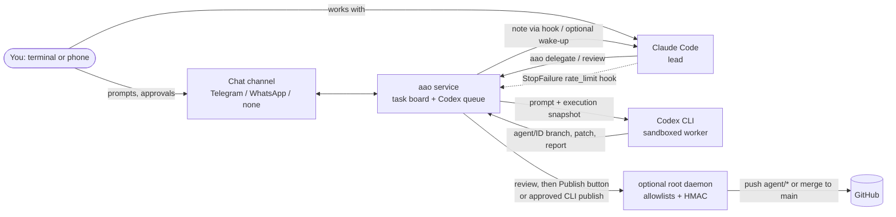

# ai-agents-orchestrator

[](https://github.com/JonasaAugusto/ai-agents-orchestrator/actions/workflows/ci.yml)
[](LICENSE)
[](pyproject.toml)

[Português (Brasil)](README.pt-BR.md)

**Run Claude Code and OpenAI Codex CLI as one relay team, on the subscriptions you already pay for.**

Claude Code leads: it plans, talks to you and reviews. Codex works as a second engineer on isolated branches:
it picks up delegated tasks, cross-reviews Claude's branches and, when Claude hits its usage limit, takes the baton
and keeps going until Claude is back. You stay in charge from the terminal or your phone: nothing is merged or
deployed without your explicit approval.

- **No API keys.** It drives the official `codex` and `claude` CLIs with your own logins.
- **Safe by default.** Codex runs unprivileged, in its sandbox, without network, in throwaway clones; publishing needs a human.
- **Honest results.** A task whose report says `partial` or `blocked` is never shown as done, whatever the exit code.
- **Python standard library only.** One optional extra (WhatsApp). Tested on Python 3.11 and 3.12.

## Contents

[How it works](#how-it-works) · [Features](#features) · [Security model](#security-model) · [Quickstart](#quickstart) ·
[Claude Code plugin](#claude-code-plugin) · [Watching Codex live](#watching-codex-live) · [Chat channels](#chat-channels) ·
[Telegram commands](#telegram-commands) · [CLI reference](#cli-reference) · [Configuration](#configuration) ·
[FAQ](#faq) · [Limitations](#limitations) · [Roadmap](#roadmap) · [Glossary](#glossary)

## How it works



1. **Delegation.** Claude (or you, from the chat) queues a task with the files it touches. The service clones the repo
   from a freshly verified mirror into a throwaway workspace on a new `agent/<id>-<slug>` branch and runs Codex there.
2. **Execution snapshot.** Every prompt starts with facts generated in code: time, base SHA of each repo (checked
   against GitHub), the real sandbox, network, model and effort, and the age of the living briefing. The mirror must be
   provably current or the task is blocked before anything runs.
3. **Honest delivery.** When Codex ends, the service commits on the branch (never Codex), keeps stray notes out of the
   commit, flags large document deletions and time-dependent tests, writes `HANDOFF.md` and patches, and reads the
   first line of the report: `Status: completed | partial | blocked`.
4. **Review and publish.** Claude reviews the branch (see the [review protocol](#claude-code-plugin)). Publishing is a
   merge `--no-ff` into the base branch, only after a human approval: the owner's [Publish] button, or
   `aao publish <id>` for tasks Claude delegated, run by the owner as root in an interactive terminal (they type the
   task id to confirm; a flag alone never publishes). Production deploys are a second, separate button.
5. **Usage-limit handoff.** When Claude Code hits its limit, a hook calls `aao claude-limit`. Codex checks Claude's
   living briefing against a masked tail of the transcript, proposes tasks, and (with `/auto` on) continues on its own
   branches. When the limit resets, Claude gets a note (and, optionally, a wake-up message) and takes the baton back.

## Features

| Area | What you get |
| --- | --- |
| Task board | SQLite board shared by Claude and Codex; owners, origins, dependencies, file-overlap locks, hourly limits |
| Delegation | `aao delegate`, `aao wait`, per-task briefings, `aao review` for cross-review by Codex |
| Honest states | `completed` / `partial` / `blocked` parsed from the report; blocked never becomes review, partial has no publish button |
| Handoff | StopFailure hook, Codex verdict as strict JSON, handoff notes for Claude, daily cap of checks |
| Living briefing | `BRIEFING.md` read first by Codex; stale/future/missing timestamps and diverging SHAs become warnings |
| Git hygiene | throwaway clones from a bare mirror, `agent/*` branches only, no force/tags/deletes, append-only audit log |
| Publishing | human approval always; optional root daemon with GitHub allowlist, HMAC-signed single-use merge requests, exact-allowlist deploys |
| Privacy | masking of secrets and personal data in everything the model reads from Claude's transcript and memory |
| Chat | Telegram (buttons, signed single-use callbacks), unofficial WhatsApp (opt-in), or none |
| Live view | masked per-task event log, `aao watch`, tmux/terminal opener, experimental Claude Code side pane |
| Operations | `aao setup`, `aao doctor`, graceful restarts that resume interrupted work once, chat history for Claude |

## Security model

| Default | Why |
| --- | --- |
| Codex runs as an unprivileged system user (`aao`) | it can only touch what that user can |
| `--sandbox workspace-write`, network **off** | writes only inside the throwaway clone; `codex.network_access = true` to allow outbound network |
| `danger-full-access` only with `codex.full_access = true` | explicit, warned opt-in; `aao doctor` flags it |
| Publishing requires a human | button with HMAC-signed, expiring, single-use callback, or root CLI where the owner types the task id at an interactive terminal |
| Nothing is pushed unless allowlisted | `publish.push_allowlist` is empty by default |
| Secrets stay out of the service user's reach | bot token and publish key come from a root-only 0600 `EnvironmentFile` |
| Engines get a minimal environment | no tokens or keys in Codex's environment; the service is non-dumpable and drops the secrets from its own environment at start |
| Root never runs repo config it does not own | hardened git (no hooks, fsmonitor, helpers, proxies); mirrors are fetched into root-only clones and copied out |
| One chat owner | every other chat, user or group is ignored without an answer |
| Root daemon is optional and narrow | fixed operations, peer-uid check, refuses to start if its code is writable by non-root |
| Claude session wake-up is off | experimental, uses an undocumented local socket format; it only sends a fixed notice (task id + state), never agent text |
| Dev secrets are masked too | `privacy.mask_dev_secrets = true` by default |

Read [SECURITY.md](SECURITY.md) for the threat model and how to report vulnerabilities.

## Quickstart

Linux with systemd, Python 3.11+, git, the [Codex CLI](https://github.com/openai/codex) and
[Claude Code](https://docs.anthropic.com/en/docs/claude-code) installed.

**1. Install**

```bash
sudo useradd --system --home-dir /var/lib/ai-agents-orchestrator --create-home --shell /usr/sbin/nologin aao
sudo python3 -m venv /opt/ai-agents-orchestrator
sudo /opt/ai-agents-orchestrator/bin/pip install git+https://github.com/JonasaAugusto/ai-agents-orchestrator   # not on PyPI yet
sudo ln -s /opt/ai-agents-orchestrator/bin/aao /usr/local/bin/aao
# optional, unofficial WhatsApp channel:  sudo /opt/ai-agents-orchestrator/bin/pip install 'ai-agents-orchestrator[whatsapp] @ git+https://github.com/JonasaAugusto/ai-agents-orchestrator'
```

**2. Configure with the wizard**

```bash
sudo aao setup
```

It asks for the service user, state directory, timezone, Claude Code transcripts folder, **the chat channel**
(Telegram / WhatsApp / none) and the repositories, then writes `/etc/ai-agents-orchestrator/config.toml` (0640 root:<service group>) and the
secrets file `/etc/ai-agents-orchestrator/env` plus `publish.key` (0600, root). For Telegram it tells you how to get
the token (talk to **@BotFather**, `/newbot`) and **your numeric user id** (send any message to **@userinfobot**).

> **Without a chat channel you cannot send prompts to Codex from your phone, receive its notifications, or approve
> publishing with a button. Telegram is the channel that enables this.** Everything else works through the CLI and
> Claude Code (delegate, status, review, publish with explicit CLI approval).

Copy and adapt the examples the config points to:

```bash
sudo cp rules/BASE_RULES.example.md /etc/ai-agents-orchestrator/BASE_RULES.md
sudo cp rules/DIVISION.example.md   /etc/ai-agents-orchestrator/DIVISION.md
sudo mkdir -p /etc/ai-agents-orchestrator/templates   # AGENTS.<repo>.md files, see templates/AGENTS.example.md
```

**3. Log Codex in, with the official command, as the service user**

```bash
sudo -u aao env HOME=/var/lib/ai-agents-orchestrator CODEX_HOME=/var/lib/ai-agents-orchestrator/.codex codex login --device-auth
```

`--device-auth` is for headless servers: open the URL it prints and type the code (it may need device-code login
enabled in your ChatGPT security settings); on a machine with a browser, plain `codex login` works. This project never
reads, copies or prints credential files; it checks the login only with `codex login status`. If the login expires, the
service pauses the queue and sends you this same command.

**4. Check everything**

```bash
sudo aao doctor
```

It checks the config, the service user, Codex installed and logged in, Claude Code and its hooks, the chat channel
(token, owner id, 0600 secrets file, WhatsApp opt-in), git access to every repository and the push allowlist, and
prints a fix for each problem. `aao doctor --json` for scripts.

**5. Start the services** (examples with placeholders in [`examples/systemd/`](examples/systemd))

```bash
sudo cp examples/systemd/*.service /etc/systemd/system/
sudo systemctl daemon-reload
sudo systemctl enable --now ai-agents-orchestrator.service
sudo systemctl enable --now ai-agents-orchestrator-root.service   # optional: mirrors, pushes, deploys
```

**6. Connect Claude Code** with the [plugin](#claude-code-plugin) (or merge
[`examples/claude-hooks.json`](examples/claude-hooks.json) into `~/.claude/settings.json`), then opt in to the
automatic handoff, which sends a masked tail of your transcript to OpenAI:

```bash
aao arm        # aao disarm to turn it off
```

Try it without any account: `aao serve --dry-run` uses fake engines and no chat channel.

## Claude Code plugin

The repository is a Claude Code plugin marketplace. In a Claude Code terminal session:

```
/plugin install ai-agents-orchestrator --marketplace JonasaAugusto/ai-agents-orchestrator
```

From a shell: `claude plugin install ai-agents-orchestrator --marketplace JonasaAugusto/ai-agents-orchestrator`.
The `aao` CLI must be on PATH. It installs:

- **Skill `orchestrator-workflow`**: when to delegate and when to do it yourself; write task descriptions to a file and
  pass `--briefing <file>` or `"$(cat file)"` (inline text with backticks gets executed by the shell); wait for the
  note or wake-up instead of polling; the **review protocol** (read the diff, prove each new test fails without the
  patch, run the full suite yourself against disposable data, never trust the agent's own report alone); partial and
  blocked are not done; publish only after review and human approval (production needs its own approval); keep the
  living briefing at most 40 lines and update it at milestones; no secrets in task text; serialize tasks that touch the
  same files from the same base.
- **Hooks**: `StopFailure` (`rate_limit`) runs `aao claude-limit`; `UserPromptSubmit` and `SessionStart` run
  `aao hook-prompt`, which delivers pending notes from Codex and a reminder when the briefing is stale.
- **Slash commands**: `/delegate <repo> <task>`, `/orchestrator-status`, `/review-task <id>`, `/codex [id]`.

An **experimental** companion, `aao-codex-pane`, adds `/codex-pane [id]`: a live side pane inside Claude Code. It is
built on Claude Code's early-access function-hooks API, which may change between releases:

```
/plugin install aao-codex-pane --marketplace JonasaAugusto/ai-agents-orchestrator
```

## Watching Codex live

The service appends every Codex event of a task, masked, to `<state_dir>/resultados/<id>/events.jsonl`. Watching only
reads that file: it never interferes with the task, and you can replay a finished task later.

- `aao watch [id]`: header (task, repo, branch, workspace), the events so far, then follows until the task ends,
  finishing with the diff so far. Default id: the running task. `--no-follow` prints and exits.
- `aao watch-open [id]`: opens `aao watch` in a **tmux split** when you are inside tmux, else in a **new terminal
  window** (x-terminal-emulator, gnome-terminal, konsole, kitty, alacritty, wezterm, xterm...), else prints the command
  to run in another terminal.
- In Claude Code: `/codex [id]`, `/codex-pane [id]` (experimental pane), or just ask in plain language,
  *"open codex"*, *"show me what codex is doing"*, *"abre o codex"*: the skill tells Claude to open the view.

Example output (illustrative):

```
== Codex on task #12: Validate signup e-mails [in progress]
   repo: web-app  branch: agent/12-validate-signup-e-mails
   workspace: /var/lib/ai-agents-orchestrator/workspaces/web-app/12
[14:02:11] session started
[14:02:15] $ python -m pytest -q tests/test_signup.py
[14:02:19]   -> exit 1: 1 failed, 4 passed
[14:03:02] edit: update app/signup.py, add tests/test_signup_email.py
[14:03:40] $ python -m pytest -q
[14:03:47]   -> exit 0: 31 passed
[14:03:55] codex: Status: completed ...
== diff so far:
 app/signup.py                 | 14 ++++++++++++--
 tests/test_signup_email.py    | 38 ++++++++++++++++++++++++++++++++++++++
== task #12 is in review
```

## Chat channels

`service.channel = "telegram" | "whatsapp" | "none"`. The bot logic is channel-agnostic (`canal.py`: send text,
send with buttons, receive messages and button presses, allowed-user check), so other channels can be added.

**Telegram** (recommended): free text goes to Codex (read-only, or editing on an `agent/chat-<date>-<n>` branch when
a repository is known), every state change asks for a button, buttons are HMAC-signed, expire after 10 minutes and
work once per group. Only `telegram.chat_id`, in a private chat, is answered.

**WhatsApp (unofficial, at your own risk).** A full replacement for Telegram: free-text prompts to Codex, task
notifications, approvals and commands, with buttons rendered as numbered replies ("1. Publish / 2. Review first /
3. Don't publish").

> ⚠️ **WARNING:** this channel uses an **unofficial** WhatsApp Web client (the optional `neonize` package). It is **not
> affiliated with, endorsed by or supported by WhatsApp or Meta**. It **may violate WhatsApp's Terms of Service** and
> **the number can be restricted or banned**. Use a **secondary number**, **at your own risk**; this project gives
> **no guarantee**. It only runs with `whatsapp.accept_unofficial_risk = true`, and `aao setup` asks you to type
> `I ACCEPT THE RISK`.

Safety measures for the number: it talks only to `whatsapp.owner_number` and ignores everyone else and groups; the
destination is fixed, so it cannot message anyone else; no bulk sending (rate limit, default 12 messages per minute
plus a minimum gap); reconnects with exponential backoff (5 s up to 15 min) and stops for good on logout or a temporary
ban; session files live in `<state_dir>/whatsapp` (0700/0600), outside any repository and ignored by `.gitignore`.
Pairing happens in `aao setup`, with a pairing code or a QR code in the terminal.

**None**: CLI and Claude Code only (see the notice in the Quickstart).

## Telegram commands

Commands are registered in the bot menu. Portuguese aliases from the project's origins also work
(`/tarefa`, `/quadro`, `/pausar`...).

| Command | What it does |
| --- | --- |
| *free text* | conversation with Codex; edits code on an `agent/chat-*` branch when the repo is known |
| `/task [repo] <text>` | formal task for Codex (confirm / edit / cancel) |
| `/board` | open tasks with View / Assign to Codex / Assign to Claude / Cancel |
| `/status` | engine, model, effort, queue, Claude state, briefing age |
| `/usage` | plan usage windows reported by Codex, plus local counters |
| `/model`, `/effort [level]` | choose Codex model and reasoning effort |
| `/engine` | codex, claude (headless) or auto |
| `/repos`, `/repo <name>` | allowed repositories / default repository |
| `/context` | Codex checks the briefing and the transcript tail now |
| `/pause`, `/resume`, `/cancel` | control the queue |
| `/last`, `/diff`, `/branches` | latest result, diff stat, agent branches |
| `/new` | end the chat session; the next message starts a new branch |
| `/auto` | automatic continuation on Claude's limit on/off |
| `/cap [n]` | daily cap of Codex limit checks |
| `/limit` | latest evidence of a Claude usage limit |
| `/logs`, `/history [N]` | recent log lines (masked) and chat history |
| `/help` | this list |

## CLI reference

Every command is `aao <command>` (also installed as `ai-agents-orchestrator`). Portuguese aliases are accepted.

| Command | Purpose |
| --- | --- |
| `setup`, `doctor [--json]` | configure; check and get fix instructions |
| `serve [--dry-run] [--no-chat]` | run the service |
| `root-daemon` | run the optional privileged daemon |
| `delegate --repo R --title T [--files a,b] [--briefing FILE \| --briefing-text TXT] [--description D]` | queue a task for Codex |
| `list [--state S] [--owner claude\|codex]`, `show ID`, `result ID`, `cancel ID`, `claim ID [--owner] [--files]` | board |
| `wait ID [--timeout S]` | block until a final state (exit 0 review/completed, 1 blocked/cancelled, 2 timeout) |
| `review --repo R --branch B` | cross-review by Codex (read-only) |
| `publish ID` | root only, interactive terminal: the owner types the task id to merge + push a reviewed task delegated by Claude |
| `watch [ID] [--no-follow]`, `watch-open [ID]` | live view |
| `status`, `pause`, `resume` | service state and queue |
| `arm`, `disarm` | automatic handoff on Claude's usage limit |
| `claude-limit`, `hook-prompt [--event E]`, `claude-resumed`, `note` | Claude Code hook glue and notes |
| `briefing-status`, `briefing-check` | living briefing |
| `history [--last N] [--since YYYY-MM-DD] [--search TEXT]` | chat channel history |
| `mirror [--no-repos]` | refresh the mirror now |
| `check-rules [--file F]` | lint the base rules (expired review date only warns) |
| `install [--source DIR] [--dest DIR]` | root-owned install from a reviewed git checkout (self-editing setups) |

## Configuration

One TOML file, documented in [`examples/config.example.toml`](examples/config.example.toml). Every key can be
overridden by `AAO_<SECTION>_<KEY>` (e.g. `AAO_SERVICE_TASKS_PER_HOUR=3`); secrets come from the environment
(`AAO_TELEGRAM_TOKEN`, `AAO_PUBLISH_KEY`). Repositories are `[repos.<name>]` tables (or a JSON file, see
[`examples/repos.example.json`](examples/repos.example.json)) with `github`, `base_branch`, an optional local `source`
and `local = true` for repositories without a remote. Deploy commands live in a root-only allowlist,
[`examples/publish.example.json`](examples/publish.example.json).

## FAQ

**Does it need API keys?** No. It runs the `codex` and `claude` CLIs with the logins you already have; usage counts
against those plans.

**Is it allowed by the providers' terms?** It only automates the official CLIs on your own machine for your own work.
Check your plan's terms for automation and concurrency yourself; the WhatsApp channel is a separate, explicit risk.

**What does OpenAI receive?** The task prompts, the repositories Codex works on and, if you run `aao arm`, a masked tail
of your Claude Code transcript and memory files. Masking is pattern based.

**Can Codex push to main?** No. The service commits; only the root daemon pushes, only `agent/*` branches of
allowlisted repos, and merges into the base branch need your signed approval.

**Do I need the root daemon?** No. Without it, tasks still run on local mirrors and you get branches and patches;
you integrate them yourself.

**Why are some identifiers in Portuguese?** The project started as an internal tool in Brazil. User-facing text is
English; see the [glossary](#glossary).

## Limitations

- Linux and systemd are assumed for the service, the sandbox and the examples; macOS is untested.
- Codex's usage-limit message format is not documented; detection is tolerant but may miss new wording.
- The handoff covers limits that reach the StopFailure hook; a limit hit with the session closed is noticed only by `/context`.
- Secret masking is regex based; secrets in unusual formats can slip through.
- The experimental Claude Code wake-up and the `/codex-pane` panel depend on undocumented or early-access interfaces.
- The WhatsApp channel was tested with fakes only, not against a live WhatsApp account; pairing and reconnection
  depend on the third-party library.
- One owner per installation; no multi-user roles.

## Roadmap

- Official **WhatsApp Business Cloud API** channel (Meta), in Python, behind the same channel interface. It needs a
  public HTTPS webhook and a Meta business app; limitations to document: per-conversation pricing and the 24-hour
  customer-service window for free-form replies.
- More channels (Slack, Matrix, e-mail) through the channel interface.
- English internal identifiers, with migration of existing databases.
- Container image and non-systemd service examples.
- Richer `aao watch` filters and a web dashboard.

## Glossary

Internal names you may see in JSON output and the database: `tarefa` task, `quadro` board, `dono` owner
(`claude`/`codex`), `origem` origin (`claude` delegated by Claude, `dono` from the owner's chat, `handoff` taken over on
Claude's limit), `estado` state: `pendente` pending, `em_andamento` in progress, `em_revisao` in review, `concluida`
completed, `bloqueada` blocked, `cancelada` cancelled. `espelho` mirror, `recado` note, `resumo` summary, `aviso` warning.

## License

[MIT](LICENSE) © 2026 Jonas Augusto. Not affiliated with Anthropic, OpenAI, Telegram, WhatsApp or Meta. Claude, Codex,
Telegram and WhatsApp are trademarks of their respective owners.
