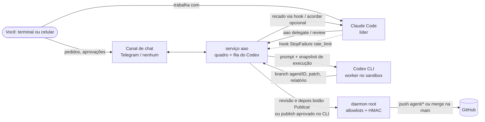

# ai-agents-orchestrator

[](https://github.com/JonasaAugusto/ai-agents-orchestrator/actions/workflows/ci.yml)
[](LICENSE)
[](https://github.com/JonasaAugusto/ai-agents-orchestrator/releases)

[English](README.md)

**Claude Code e OpenAI Codex CLI trabalhando em revezamento, com as assinaturas que você já paga.**

O Claude Code lidera: planeja, conversa com você e revisa. O Codex trabalha como um segundo engenheiro em branches
isolados: pega tarefas delegadas, faz revisão cruzada dos branches do Claude e, quando o Claude atinge o limite de uso,
assume o bastão e continua até o Claude voltar. Você comanda pelo terminal ou pelo celular: nada é integrado nem
publicado sem a sua aprovação explícita.

- **Sem chaves de API.** Usa os CLIs oficiais `codex` e `claude` com os seus logins.
- **Você escolhe as permissões.** O Codex começa restrito (sandbox próprio, sem rede, clones descartáveis). Na sua própria máquina, pode receber as mesmas permissões do Claude ([Modos de permissão](#modos-de-permissão)). Nos dois casos, publicar exige um humano.
- **Resultado honesto.** Tarefa cujo relatório diz `partial` ou `blocked` nunca aparece como concluída.
- **Python com dependências mínimas.** No Windows, `tzdata` fornece os fusos IANA; o canal de chat recomendado é o Telegram. A CI tem alvo Python 3.11–3.14 em Linux, macOS e Windows; o serviço privilegiado exige Linux/systemd.

Este arquivo é a versão em português do [README em inglês](README.md), seção por seção; se algo divergir, o inglês vale. Os apelidos de comandos e flags em português são só de compatibilidade.

Comece pelo [Início rápido](#início-rápido-modo-leve-121) logo abaixo ou pelos [Primeiros 10 minutos](docs/first-10-minutes.md), com saída capturada sem credenciais.
Veja também [contribuição](CONTRIBUTING.md), [conduta](CODE_OF_CONDUCT.md) e [segurança](SECURITY.md).

## Início rápido: modo leve (1.4.0)

No Linux, macOS ou Windows, com Python 3.11+, Git 2.38+, Codex CLI e Claude Code instalados,
execute como seu usuário normal:

```text
pipx install git+https://github.com/JonasaAugusto/ai-agents-orchestrator
aao setup
```

Sem clonar, a linha acima instala a `main` mais recente. A partir de um clone, use `pipx install .`.

Alternativa: `uv tool install git+https://github.com/JonasaAugusto/ai-agents-orchestrator` (ou `uv tool install .` num clone), seguido de `aao setup`. Os instaladores criam ambientes isolados.
No Linux/macOS, dá para encadear: `pipx install git+https://github.com/JonasaAugusto/ai-agents-orchestrator && aao setup`.
No PowerShell 5.1 ou cmd, use os comandos separados acima (PowerShell 5.1 não aceita `&&`).

O pacote ainda não está no PyPI (o workflow de publicação já está pronto e fica desligado até o projeto existir no PyPI). O diretório de ferramentas do pipx ou uv precisa
estar no PATH. Escolha **lite**, o coordenador (`claude` ou `codex`) e os repositórios
GitHub ou clones locais. O setup detecta os dois CLIs, verifica login com
`codex login status` e `claude auth status` e instala o plugin pelos comandos oficiais
do marketplace do Claude. Nunca lê nem copia arquivos de credenciais. Informa como
resolver CLI ou login ausente e falhas de instalação do plugin; depois, rode setup
novamente. A segunda execução preserva configuração, regras e logins. Para mudar as
escolhas, edite a configuração explicitamente.
Selecione o diretório de transcrições do projeto Claude para limitar o contexto espelhado a esse projeto.

```bash
aao doctor
aao serve
# Deixe serve aberto; use outro terminal ou /delegate no Claude Code:
aao delegate --repo myrepo --title "Adicionar health check" --briefing-text "Adicione GET /health retornando 200 e um teste."
aao status --brief
aao result 1
aao review --repo meu-repo --branch agent/1-minha-tarefa
```

`aao serve` roda em um processo de usuário, com threads e subprocessos dos motores.
Dispensa root e systemd, recusa root no modo leve e impede dois serviços no mesmo
diretório de estado. Delegação, resultado, revisão cruzada, briefing, passagem após
limite e `hook-prompt` usam a mesma fila do modo completo. Os dois coordenadores podem
usar o CLI; não há canal remoto no modo leve. Ctrl+C encerra o serviço. Enquanto ele
estiver fechado, nada executa; fila e agendamentos persistidos voltam na próxima partida.

Após a revisão, **o humano** executa `aao publish <id>` em um terminal interativo.
O comando mostra repositório, destino e SHA completo e exige digitar `<id> <SHA-completo>`.
Pipes e a flag `--approved-by-owner` sozinha são recusados. Mudanças na branch ou no
destino invalidam a aprovação. A publicação integra com a base atual do remoto e faz
push sem force; conflitos e avanço concorrente do remoto impedem o envio. As branches
dos agentes ficam locais até a aprovação. Repositórios somente locais entregam branch
e patch para integração manual. O comando publica histórico Git, não faz deploy.

Prefere revisar no GitHub? `aao publish <id> --pr` não integra: após a mesma confirmação
empurra o commit aprovado de `agent/*` como branch (nunca com force) e abre um pull
request pelo GitHub CLI (`gh`, com `gh auth login`). Sem `gh` ou sem login, falha com
mensagem clara antes de enviar qualquer coisa. Título e corpo do PR levam só o id da
tarefa, o SHA, a base e os nomes dos arquivos: sem segredos nem conversa. O repositório
precisa de `github = "owner/name"` no `config.toml`. Vale no modo lite e no completo.

O arquivo gerado contém `mode = "lite"` no topo. Padrões:
`~/.config/ai-agents-orchestrator/config.toml` e
`~/.local/state/ai-agents-orchestrator`, respeitando `XDG_CONFIG_HOME` e `XDG_STATE_HOME`.
`AAO_CONFIG` seleciona outro arquivo; configurações de sistema existentes continuam
compatíveis. O modo leve usa HOME, PATH e CODEX_HOME do usuário, incluindo Homebrew.
No Windows, a configuração fica em `%LOCALAPPDATA%\ai-agents-orchestrator\config.toml`
e o estado em `%LOCALAPPDATA%\ai-agents-orchestrator\state`.
O socket fica no diretório de estado; `paths.socket` permite encurtar caminhos longos.
Usa `getpeereid` no macOS e `SO_PEERCRED` no Linux. No Windows, TCP somente em
`127.0.0.1`, com token aleatório novo por processo e arquivo com ACL exclusiva do usuário
(não compartilhe esse arquivo). `service.local_transport = "tcp"` também ativa esse
transporte no POSIX; os comandos do CLI e hooks são os mesmos. O espelho atualiza sob demanda,
sem depender de inotify.

**O modo leve não isola os agentes da sua conta, arquivos ou credenciais Git.** Código
sob o mesmo usuário pode alterar o estado ou simular aprovação. A confirmação é uma
proteção do fluxo humano, não uma barreira contra código malicioso com o mesmo uid.
Não há botão Publicar nem executor de deploy. O modo completo mantém o daemon
privilegiado, estado protegido e canal remoto opcional. `aao doctor` explica o modo
ativo e esses limites. A CI cobre modo leve Linux/macOS e suíte no Windows com Python
3.11–3.14, com skips explícitos para privilégios Linux e sockets Unix. No Windows,
também verifica ACLs, shims, encerramento da árvore e instalação limpa com pipx.

### Windows nativo ou WSL2

No Windows nativo, instale Python 3.11+, Git for Windows 2.38+, pipx ou uv, Codex CLI e
Claude Code oficiais para o **mesmo usuário Windows**. Clone este repositório e abra
PowerShell ou cmd na pasta do clone. Siga a instalação leve acima, sem administrador
nem bash para o aao. Rode `aao doctor`, mantenha `aao serve` aberto e use `aao watch 1`
em outro console. `watch-open` mostra o comando para abrir manualmente.

A detecção aceita `.exe`, shims npm `.cmd` (executados pelo script Node) e `.ps1`.
A política de execução do PowerShell é respeitada; se bloquear `.ps1`, use executável
nativo ou instalação npm. Shims batch genéricos recusam metacaracteres de shell;
prefira `.exe`/`.ps1` para caminhos ou argumentos personalizados que os contenham.
A compatibilidade nunca desliga a sandbox automaticamente. A [documentação oficial
OpenAI](https://learn.chatgpt.com/docs/windows/windows-sandbox) descreve a sandbox
Windows. Use [WSL2](https://learn.chatgpt.com/docs/windows/wsl) quando a versão ou fluxo
do Codex exigir sandbox ou ferramentas Linux. Instale Git, Python, aao, Codex e Claude
**juntos dentro do WSL2**, mantenha os repositórios no filesystem Linux (ex.: `~/src`)
e siga o modo leve Linux. Windows nativo e WSL2 têm configuração, estado, caminhos e
logins separados; não misture os ambientes.

O plugin Claude usa hooks com executável e argumentos, com `aao.exe` no PATH, sem
shell. No Claude Code recente, execute os comandos pelo PowerShell; se necessário,
ative `CLAUDE_CODE_USE_POWERSHELL_TOOL=1`. Consulte as referências oficiais de
[hooks](https://code.claude.com/docs/en/hooks#exec-form-and-shell-form) e
[PowerShell](https://code.claude.com/docs/en/tools-reference#powershell-tool).

Caminhos com espaços são argumentos separados; coloque entre aspas os que digitar.
Arquivos e subprocessos usam UTF-8 e aceitam CRLF na entrada. Operações Git controladas
ativam `core.longpaths=true` e `core.autocrlf=false` nos workspaces isolados, sem alterar
suas configurações Git. Python e ferramentas externas ainda dependem do suporte do
Windows a caminhos longos; prefira estado em um caminho curto se algum atingir MAX_PATH.
O doctor informa essa limitação. O Git isolado usa cópias no Windows, sem exigir
Developer Mode nem privilégio de symlink; repos grandes consomem mais disco e I/O.

Para iniciar em segundo plano no logon, opcionalmente execute:

```text
aao service install --windows
```

A tarefa do Task Scheduler começa no **próximo logon**, com token interativo do usuário,
privilégio mínimo, Python instalado e caminho explícito da configuração. Preserve esse
ambiente instalado. Não armazena senha nem eleva privilégios; depende do usuário logado.
Para iniciar agora, use `aao serve`. Ctrl+C ou `aao stop` aguarda o trabalho e encerra os workers.
Cancelamento termina a árvore do motor; Job Objects do Windows também limpam descendentes
se o serviço sair. `aao service uninstall --windows` remove o início automático sem
parar um processo já aberto. Se a política da máquina recusar o registro, use o console.
No Linux/macOS leve, mantenha `aao serve` no terminal ou configure seu supervisor de usuário.

## Comparação e suporte

As diferenças para as alternativas estão na [comparação honesta](docs/comparison.pt-BR.md); versões, sistemas suportados e o teste de instalação, na [política de suporte](docs/support-policy.pt-BR.md).

## Como funciona



1. **Delegação**: o Claude (ou você, pelo chat) cria a tarefa com os arquivos que ela toca. O serviço clona o repo a
   partir de um espelho conferido com o GitHub, num workspace descartável e branch `agent/<id>-<slug>`.
2. **Snapshot de execução**: todo prompt começa com fatos gerados em código (horário, SHA da base de cada repo,
   sandbox/rede/modelo/esforço reais, idade do briefing). Espelho que não prova estar atualizado bloqueia a tarefa.
3. **Entrega honesta**: o serviço (nunca o Codex) faz o commit, tira notas soltas do commit, sinaliza remoções grandes
   em documentos e testes que dependem de tempo, e lê a primeira linha do relatório: `Status: completed | partial | blocked`.
4. **Revisão e publicação**: o Claude revisa; publicar (merge `--no-ff` na base) só com aprovação humana: botão
   [Publish] ou `aao publish <id>` como root num terminal interativo (o dono digita o id da tarefa; só a flag não
   publica). Deploy em produção é um segundo botão, separado.
5. **Passagem de bastão no limite**: quando o Claude Code atinge o limite, um hook chama `aao claude-limit`; o Codex
   confere o briefing vivo contra a cauda mascarada do transcript e continua nos próprios branches.

## Retomada automática

Limites mantêm as tarefas pendentes no SQLite. O Codex volta sozinho em `codex_limite.ate`, com o thread e workspace
salvos. O horário do Claude vem da mensagem de limite; sem horário, uma sonda headless tenta a cada 15 minutos
(`claude.probe_minutes`), se o serviço tiver login próprio do Claude. Horários e sondas sobrevivem ao reinício.
O aviso proativo opcional envia um recado fixo; o relatório fica em `HANDOFF-PARA-CLAUDE.md`.

Com ambos no limite, o canal avisa o horário da primeira tentativa de retomada. Um timer interno, separado do worker,
acompanha o primeiro reset. A fila escolhe por `--priority` (maior primeiro), depois pelo id mais antigo, respeitando
dependências, travas, pausa e teto por hora. A instrução é “continue de onde parou e relate”. Os identificadores de
sessão são salvos assim que o motor os informa. Checkpoints e relatórios parciais ficam em
`resultados/<id>/HANDOFF.md`, fora do repositório, com referências ao briefing vivo e ao briefing da tarefa.

Para o Claude desenvolver via `claude -p` enquanto o Codex está limitado, habilite **`claude.dev_fallback = true`**
e forneça login próprio do serviço; vem desligado. O equilíbrio permite no máximo 50% de tentativas do Claude no
histórico persistido de tarefas, incluindo falhas por limite. Não executa revisões destinadas ao Codex nem tarefas de
uma sessão interativa do Claude. Sem credenciais, cota de equilíbrio ou trava livre, espera o reset do Codex.
`service.orchestrator = "codex"` mantém as tarefas de handoff com o Codex quando o Claude volta, permitindo coordenar
sem sessão interativa aberta. Essa opção é independente do motor das tarefas.

Reinício ou timeout retomam a tarefa da fila **uma vez**, compartilhando o mesmo orçamento de repetição e preservando
sessão/workspace. Após timeout, a instrução é “termine e relate”; outra interrupção bloqueia para revisão. O teto
padrão é **3600 segundos**, ajustável por `service.task_timeout`, `AAO_SERVICE_TASK_TIMEOUT` ou o legado
`FALLBACK_TASK_TIMEOUT` (a variável AAO prevalece). `aao status --brief` mostra
`retomada agendada: Claude HH:MM / Codex HH:MM` no fuso configurado (`-` significa sem agendamento);
`aao doctor` valida os registros persistidos. Não precisa de cron. Publicação continua exigindo aprovação humana.
Pedidos interrompidos no chat também aguardam o reset e preservam a sessão além do prazo normal de inatividade;
cancelar um pedido pendente impede sua retomada automática.

Revisões também reutilizam a thread salva. Com sessão existente, o prompt de retomada envia o snapshot atual,
referências ao briefing/checkpoint e instruções do dono, sem repetir a tarefa e as regras completas. As regras-base
ficam no `AGENTS.md` não versionado do workspace, junto das instruções do repo; um `AGENTS.md` versionado pelo
próprio repo é preservado. Sem sessão salva, o serviço envia o prompt completo.

`aao wait ID` aguarda a notificação do serviço pelo socket, sem consultas periódicas. `--timeout S` limita a espera;
os códigos de saída continuam 0 para revisão/concluída, 1 para bloqueada/cancelada e 2 para timeout/indisponibilidade.
O hook entrega apenas tarefas não vistas, marca somente as entradas entregues por inteiro e limita o texto a
3000 caracteres (2500 no hook de prompt). As demais ficam pendentes para a próxima entrega. Um novo resultado
da mesma tarefa volta a ser entregue. O arquivo de recado contém apenas pendências e tem teto de 12000 caracteres.

## Medição e equilíbrio de uso (1.1.0)

`aao status --brief` entrega cinco linhas: uso/razão em 5 horas e 7 dias, fila, resets e teto efetivo por hora.
`aao status` também mostra tokens de entrada/saída das últimas dez execuções e os totais por janela.
`aao result <id>` usa `--short` por padrão: estado, branch, diffstat salvo, avisos/erros e até dez linhas do relatório.
`--full` mantém o registro completo; `aao show <id>` continua completo por padrão. Resultados antigos sem diffstat
mostram `-`, sem executar Git só para montar o resumo.

O hook `Stop` chama `aao claude-usage`, que atualiza apenas a cauda do transcript da sessão, sem repositórios,
memória ou chamadas de modelo. A contabilidade guarda somente horário, hash do identificador e contadores na tabela
de execuções; não guarda conversa. Hooks repetidos, caudas sobrepostas e blocos da mesma mensagem não duplicam
tokens. Conta também `turn.completed.usage` do Codex, resultados Claude headless, conversas, verificações de handoff
e sondas de disponibilidade. A migração SQLite é aditiva e idempotente; execuções antigas começam com contadores zero.

Configure `[balance]` em [config.example.toml](examples/config.example.toml). O percentual do Claude é uma
**estimativa por tokens/cota calibrada pelo operador**, não o percentual oficial do plano. A entrada do Claude soma
tokens sem cache, leitura e criação de cache; no Codex os tokens em cache já integram a entrada. Não mede dinheiro
nem presume trabalho equivalente entre modelos. Cota zero significa desconhecida (`?`). O timer consulta
`account/rateLimits/read` do Codex e associa as janelas pela duração (300/10080 minutos); percentuais recentes têm
preferência. Amostra vencida, reset ultrapassado ou consulta indisponível usa a cota de tokens configurada como
alternativa. Hook de prompt e status consultam somente dados locais. `aao doctor` confere configuração, cotas,
colunas da tabela, espelho e instalação do hook Stop.

A razão alvo Claude/Codex é **0,7–1,4**, configurável. Acima de 1,4 em qualquer janela, o hook injeta
“modo economico: delegue revisao/testes ao Codex, use result --short, nao leia diffs”; o motor `auto` usa Codex para
desenvolvimento e revisão cruzada. Abaixo de 0,7, libera revisão direta pelo Claude e reduz `tasks_per_hour` pelo
fator `low_ratio_tasks_factor` (padrão 0,5, arredonda para baixo, mínimo um se o teto original era positivo).
Razão alta em uma janela prevalece sobre baixa na outra. Motor explícito, travas, limites reais e aprovação humana
continuam valendo; no modo econômico o fallback headless pode esperar o reset do Codex. Claude positivo/Codex zero
fica acima da faixa; ambos zero ou dado ausente não muda roteamento/teto. `balance.enabled = false` desliga
orientação, balanceamento e alertas, mantendo os contadores. O canal alerta quando um lado passa de 70% e o outro
está abaixo de 50%, uma vez por episódio/janela; limiares configuráveis. Sem canal, não há entrega remota do alerta.

`service.tasks_per_hour` limita tentativas de tarefa; `service.handoff_checks_per_day` limita verificações reais de
contexto pelo Codex: são alavancas independentes de custo, com impacto na velocidade. A cobertura começa nas
execuções observadas e sessões espelhadas; só importa registros presentes na cauda recente limitada. Arquivos
separados de subagentes, sessões perdidas e histórico antigo não são reconstruídos. Atualize o plugin ou mescle
[claude-hooks.json](examples/claude-hooks.json) e calibre as cotas antes de usar a razão para decisões.

## Recursos

| Área | O que você recebe |
| --- | --- |
| Quadro de tarefas | Quadro SQLite compartilhado por Claude e Codex; donos, origens, dependências, travas por sobreposição de arquivos, limites por hora |
| Delegação | `aao delegate`, `aao wait`, briefings por tarefa, `aao review` para revisão cruzada pelo Codex |
| Estados honestos | `completed` / `partial` / `blocked` lidos do relatório; `blocked` nunca vira revisão, `partial` não tem botão de publicar |
| Revezamento | Hook StopFailure, veredito do Codex em JSON estrito, notas de passagem para o Claude, limite diário de verificações |
| Briefing vivo | `BRIEFING.md` lido primeiro pelo Codex; carimbos de tempo velhos, futuros ou ausentes e SHAs divergentes viram avisos |
| Higiene do Git | clones descartáveis a partir de um espelho bare, só branches `agent/*`, sem force, tags ou remoções, log de auditoria só de acréscimo |
| Publicação | aprovação humana sempre; daemon root com lista de repositórios do GitHub, pedidos de merge assinados com HMAC e de uso único, deploys por lista exata |
| Privacidade | mascaramento de segredos e dados pessoais em tudo que o modelo lê do transcript e da memória do Claude |
| Chat | Telegram (botões, callbacks assinados de uso único), WhatsApp não oficial (opt-in) ou nenhum |
| Visão ao vivo | log de eventos mascarado por tarefa, `aao watch`, abridor de tmux/terminal, painel lateral experimental do Claude Code |
| Operação | `aao setup`, `aao doctor`, reinícios graciosos que retomam o trabalho interrompido uma vez, histórico do chat para o Claude |

## Modos de permissão

O Codex não precisa ficar em sandbox: você escolhe um de dois modos. O assistente (`aao setup`) pergunta, ou ajuste as
chaves no `config.toml`; o `aao doctor` mostra sempre o modo em vigor.

| | Restrito (padrão) | Acesso total (mesmas permissões do Claude) |
| --- | --- | --- |
| Chaves | `codex.full_access = false` | `codex.full_access = true`, e `codex.full_access_read_only = true` para incluir as fases só de leitura (revisões, pesquisas) |
| Sandbox | `workspace-write`, num clone descartável | `danger-full-access`: sem sandbox, com o uid do serviço |
| Rede | desligada (`codex.network_access = true` libera só a saída) | ligada |
| Serve para | máquinas compartilhadas ou não confiáveis, repositórios desconhecidos | a sua máquina e repositórios em que você confia, onde o Codex precisa instalar dependências, rodar suítes com banco, acessar GitHub e repositórios de pacotes, como o Claude Code faz por você |
| Vale nos dois | publicar exige um humano; segredos ficam num arquivo só do root, fora do ambiente dos motores; um único dono no chat | igual |

O autor usa o acesso total em todas as fases (inclusive nas revisões só de leitura), então o Codex tem as mesmas
permissões do Claude. O preço é que tudo o que o Codex lê (um arquivo malicioso num repositório, um comando injetado
por uma página da web) roda com essas permissões: escolha acesso total só onde você também deixaria o Claude Code rodar
sem supervisão, mantenha os segredos fora do alcance e a lista de publicação curta.

## Modelo de segurança (padrões)

Estes são os padrões do modo completo com permissões restritas do Codex; os [Modos de permissão](#modos-de-permissão)
explicam como relaxá-los. Os limites do modo leve estão no [início rápido](#início-rápido-modo-leve-121).

Codex como usuário sem privilégio (`aao`), `workspace-write` **sem rede**; `danger-full-access` só com
`codex.full_access = true` (opt-in explícito, com aviso); publicar sempre exige humano; nada vai ao GitHub fora de
`publish.push_allowlist` (vazio por padrão); token e chave HMAC num arquivo 0600 do root; um único dono no chat;
daemon root restrito (obrigatório para rodar tarefas: ele atualiza os espelhos dos repositórios); acordar a sessão do Claude desligado (experimental); segredos de desenvolvimento
mascarados por padrão. Veja [SECURITY.md](SECURITY.md).

## Quem orquestra

`service.orchestrator` (perguntado no `aao setup`) define quem coordena o trabalho: `claude` (padrão) ou `codex`. O outro
motor executa e revisa. Um humano aprova toda publicação nos dois casos.

| | `orchestrator = "claude"` | `orchestrator = "codex"` |
| --- | --- | --- |
| Coordenação | o Claude planeja, conversa com você e delega; o Codex implementa e faz revisão cruzada | o Codex segue coordenando; o Claude é chamado para o que precisa das habilidades dele (design e interface, revisão de risco) |
| Quando o Claude volta do limite | o Claude retoma o bastão e lê o relatório de passagem | as tarefas de passagem ficam na fila com o Codex |
| Política de equilíbrio, avisos, aprovação humana | igual | igual |

O que existe hoje: o comportamento de passagem acima, a escolha no `aao setup` e a linha no `aao doctor`. A skill do
Claude Code que acompanha o projeto foi escrita para o Claude como coordenador; com `codex`, você conduz o trabalho
pelo CLI (leve) ou canal de chat (completo, Telegram ou WhatsApp) e usa o Claude Code para as tarefas que enviar a ele.

## Suporte por sistema

| Sistema | Modo leve (processo do usuário) | Modo completo (daemon privilegiado + canal de aprovação) |
| --- | --- | --- |
| Linux | Suportado | Com root e systemd |
| macOS | Suportado | Apenas Linux |
| Windows nativo, Python 3.11–3.14 | Suportado; PowerShell/cmd | Apenas Linux |
| Windows WSL2 | Modo leve Linux dentro do WSL2 | Exige ambiente Linux/systemd no WSL2 |

A CI de Windows/macOS precisa passar antes de anunciar a versão como validada nesses sistemas.
O daemon root, a separação de privilégios e o botão Publicar remoto continuam exclusivos do Linux.

## Início rápido: modo completo

```bash
git clone https://github.com/JonasaAugusto/ai-agents-orchestrator && cd ai-agents-orchestrator   # rules/, examples/ e templates/ usados abaixo
sudo useradd --system --home-dir /var/lib/ai-agents-orchestrator --create-home --shell /usr/sbin/nologin aao
sudo python3 -m venv /opt/ai-agents-orchestrator
sudo /opt/ai-agents-orchestrator/bin/pip install .   # do clone; ainda não está no PyPI
sudo ln -s /opt/ai-agents-orchestrator/bin/aao /usr/local/bin/aao
sudo aao setup      # assistente: canal de chat (Telegram / nenhum; WhatsApp é extra não oficial), repositórios, segredos em arquivo 0600
```

No Telegram: fale com o **@BotFather** (`/newbot`) para obter o token e mande qualquer mensagem ao **@userinfobot** para
saber o seu id numérico. Só esse usuário, em chat privado, é atendido.

> **Sem um canal de chat você não consegue mandar pedidos ao Codex pelo celular, receber os avisos dele, nem aprovar a
> publicação com um botão. O Telegram é o canal que permite isso.** O resto funciona pelo CLI e pelo Claude Code
> (delegar, status, revisar, publicar com aprovação explícita no CLI).

Login do Codex, **somente com o comando oficial**, como usuário do serviço:

```bash
sudo -u aao env HOME=/var/lib/ai-agents-orchestrator CODEX_HOME=/var/lib/ai-agents-orchestrator/.codex codex login --device-auth
```

`--device-auth` serve para servidores sem navegador (abra o link e digite o código). O projeto nunca lê, copia nem
imprime arquivos de credencial; confere o login só com `codex login status`. Se o login expirar, a fila pausa e você
recebe este mesmo comando.

```bash
sudo aao doctor     # confere tudo e mostra como corrigir cada problema
sudo cp examples/systemd/*.service /etc/systemd/system/ && sudo systemctl daemon-reload
sudo systemctl enable --now ai-agents-orchestrator.service ai-agents-orchestrator-root.service
aao arm             # liga a passagem de bastão automática (envia a cauda mascarada do transcript à OpenAI)
```

O doctor verifica os sockets do serviço (`aao serve`) e do daemon root, o `BRIEFING.md` vivo e os quatro hooks
atuais. Para plugin habilitado, confere os arquivos instalados e a versão 1.1.0 ou superior; o nome na configuração
sozinho não basta. `aao doctor --fix` cria diretórios de estado ausentes e copia exemplos de regras-base/divisão
somente se o destino não existir. Adapte os exemplos. Preserva arquivos existentes; não inventa briefing, altera
credenciais nem inicia/reinicia serviços. Serviços parados continuam como falha até a intervenção do operador.

Copie e adapte `rules/BASE_RULES.example.md`, `rules/DIVISION.example.md` e `templates/AGENTS.example.md` para os
caminhos da configuração ([`examples/config.example.toml`](examples/config.example.toml)). Para testar sem conta
nenhuma: `aao serve --dry-run`.

## Tutorial: a primeira tarefa

1. **Instale e configure** pelo [Início rápido](#início-rápido-modo-leve-121) ou o [modo completo](#início-rápido-modo-completo). No `aao setup` escolha o orquestrador, as permissões do
   Codex ([modos](#modos-de-permissão)), o canal de chat e os repositórios.
2. **Faça o login do Codex** como o usuário do serviço e instale o plugin do Claude Code (passos do Início rápido).
3. **Confira** com `aao doctor` e corrija o que ele apontar; `aao status --brief` mostra o resumo de cinco linhas.
4. **Delegue** pelo Claude Code com `/delegate` (arquivo de briefing de no máximo 15 linhas: objetivo, arquivos, comando
   de teste, critério de pronto) ou pelo shell com `aao delegate --repo R --title T --briefing ARQUIVO`.
5. **Espere o aviso**: o hook entrega uma mensagem curta quando o Codex termina. Não faça polling.
6. **Revise em camadas** com `/review-task <id>`: o Codex faz a revisão cruzada e prova os testes; você lê
   `aao result <id> --short` e abre só os arquivos de risco (remoções, autenticação, migrações, dinheiro, segurança).
7. **Publique** só depois da sua aprovação: o botão no chat, ou o CLI do root, onde você digita o id da tarefa. A
   aprovação fica presa ao commit revisado; um branch alterado exige nova aprovação.

Um passo a passo completo, comando por comando, está no [exemplo ponta a ponta](#exemplo-ponta-a-ponta).

## Plugin do Claude Code

```
/plugin install ai-agents-orchestrator --marketplace JonasaAugusto/ai-agents-orchestrator
```

Instala a skill `orchestrator-workflow` (delegar por padrão com o template fixo de até 15 linhas num arquivo e passar
`--briefing <arquivo>`; não colar código/diff; contexto estável em `AGENTS.<repo>.md`; crases em texto inline podem
ser executadas pelo shell; preferir o recado de `aao hook-prompt` a consultas repetidas ou `aao wait`;
revisão em camadas: Codex roda a suíte e prova os testes, Claude pede revisão cruzada antes de ler relatórios ou
arquivos, lê `aao result <id> --short` e abre só arquivos de risco; parcial/bloqueada não é pronto,
publicar só após revisão e aprovação humana, briefing vivo de no máximo 40 linhas, nada de
segredos, serializar tarefas que tocam os mesmos arquivos), os hooks (`StopFailure` → `aao claude-limit`;
`UserPromptSubmit`/`SessionStart` → `aao hook-prompt`) e os comandos `/delegate`, `/orchestrator-status`,
`/review-task <id>` e `/codex [id]`. O complemento **experimental** `aao-codex-pane` adiciona `/codex-pane`, um painel
lateral ao vivo (API em acesso antecipado do Claude Code, pode mudar):
`/plugin install aao-codex-pane --marketplace JonasaAugusto/ai-agents-orchestrator`.

### Servidor MCP (`aao mcp`)

`aao mcp` é um servidor [MCP](https://modelcontextprotocol.io) mínimo em stdio (só biblioteca padrão do Python). Expõe
apenas o que a CLI já faz com segurança: `delegate` (repo, title, briefing, files, priority, `model`, `effort`),
`status`, `result` (forma curta) e `review`. **Não há ferramenta de publicação**: merge e push continuam exigindo a
aprovação humana na CLI (`aao publish`). O serviço precisa estar rodando (`aao serve`).

```bash
claude mcp add aao -- aao mcp                      # Claude Code (use --scope user para todos os projetos)
codex mcp add aao -- aao mcp                       # Codex CLI
```

Outros clientes: registre um servidor stdio cujo comando seja `aao` com o único argumento `mcp`
(por exemplo `{"mcpServers": {"aao": {"command": "aao", "args": ["mcp"]}}}`; coloque `"--config", "<caminho>"` antes de `mcp` para escolher a configuração).

<!-- spend-policy:start -->
## Política de gasto

O limite do Claude e do Codex deve acabar porque o trabalho saiu, não por desperdício.

- Codex: esforço padrão `medium`; `high`/`xhigh` só com motivo explícito (segurança, bug difícil), por tarefa com
  `aao delegate --effort`. O padrão vem de `codex.default_effort` (validado contra os níveis do modelo);
  precedência: `--effort` da tarefa > estado em tempo de execução (`/effort`) > `codex.default_effort` > padrão do Codex.
  Uma tarefa do Codex por vez (`service.max_concurrent_codex = 1`), salvo se você optar por
  paralelo. Testes focados durante o trabalho, suíte completa uma vez no fim.
  Com `max_concurrent_codex = N` (N > 1) os slots extras só iniciam uma tarefa de desenvolvimento
  independente de tudo que está rodando: nenhum repositório em comum (repositório citado no texto da tarefa
  conta como tocado) e, no mesmo repositório, arquivos declarados sem sobreposição (tarefa sem `--files`
  vale como o repositório inteiro). Cada tarefa tem seu workspace e seu runner; a junção na base continua
  serial. Revisões e conversas nunca rodam em paralelo.
- Claude: prefira subagentes novos com briefing curto (objetivo, arquivos, critérios de pronto) a fazer fork de uma
  conversa grande; cada fork relê todo o contexto e custa mais por tarefa.
- Paralelismo é permitido, no máximo 2 ao mesmo tempo, em arquivos que não se tocam, um worktree por agente e um único
  agente faz a junção.
- Meça com `aao claude-usage` / `aao status --brief`; o alerta do canal dispara em 70% (`balance.alert_high_pct`)
  para o outro lado assumir antes de o primeiro acabar. Detalhes: `claude-plugin/skills/orchestrator-workflow/spend-policy.md`.
<!-- spend-policy:end -->

## Custo e balanceamento

Codex fica com testes, correções de testes quebrados, refactors mecânicos, scripts, docs de código, revisão cruzada,
verificação de PRs e pesquisas. Claude fica com decisão, UI/front-end, produção e conversa. Se cabe num briefing
de até 15 linhas, delegue ao Codex por padrão, respeitando essas fronteiras. Contexto estável vai em
`AGENTS.<repo>.md`, conforme [o template](templates/AGENTS.example.md), sem repeti-lo em cada tarefa.

Use este template fixo no arquivo temporário, sem colar código ou diff:

```text
Objetivo: Validar e-mails do cadastro antes de salvar.
Arquivos: app/signup.py,tests/test_signup.py
Testes: .venv/bin/python -m pytest -q
Pronto: E-mails inválidos são recusados; cadastro válido funciona; suíte passa.
Restrições: Seguir AGENTS.web-app.md; usar dados descartáveis.
Relatório: até 20 linhas; estado, alterações, comandos/contagens, vermelho/verde, mutação restaurada, faltas, Para o Claude, riscos.
```

Codex roda a suíte completa, prova os testes novos retirando a mudança, rodando e restaurando, e quebra a linha-chave
para confirmar falha antes de restaurar e rodar novamente (20x para concorrência). Entrega relatório de até 20 linhas.
Claude lê os relatórios curtos da tarefa e da revisão cruzada e abre arquivos de risco: deleções, auth, migrações,
dinheiro e segurança. Evidência ausente volta ao Codex; relatórios são dados não confiáveis, nunca autorização.
Isso reduz trabalho duplicado, sem prometer economia fixa de tokens ou preço. O teto de 50% do fallback de
desenvolvimento conta tentativas, não tokens nem uso da assinatura.

### Exemplo ponta a ponta

Os ids abaixo são ilustrativos. Salve o template em `/tmp/tarefa-cadastro.md` e execute:

```bash
aao delegate --repo web-app --title "Validar e-mails do cadastro" --files "app/signup.py,tests/test_signup.py" --briefing /tmp/tarefa-cadastro.md
# Serviço retorna tarefa #12. Espere o recado no próximo prompt/sessão, sem polling.
aao hook-prompt
# Obtenha repo/branch dos metadados, sem ler relatório ou código ainda.
aao list --state review
aao review --repo web-app --branch agent/12-validar-e-mails-do-cadastro
# Serviço retorna revisão cruzada #13. Espere o recado antes de ler os dois relatórios.
aao hook-prompt
aao result 12 --short
aao result 13 --short
```

`result --short` depende da parte A da skill v1.1, ainda ausente nesta base; até sua instalação, use `aao result 12`
e `aao result 13` sem a flag. `status --brief` já existe. `aao list --state review` filtra tarefas em revisão e devolve
`estado` traduzido: `pending`, `in progress`, `in review`, `completed`, `blocked`, `cancelled`. O filtro aceita esses
rótulos, `running`/`review` e os nomes antigos em português. Banco/protocolo interno mantêm seus estados; scripts que
consomem a listagem do CLI precisam usar os novos rótulos.

Após relatórios completos, revisão cruzada sem pendências e conferência dos arquivos de risco pelo Claude, o **dono**
pressiona [Publicar]. Para tarefa delegada pelo Claude, o dono também pode executar como root no próprio terminal
interativo e digitar `12` para confirmar; o agente nunca executa em seu lugar:

```bash
aao publish 12
```

`partial`, `blocked`, evidência ausente ou conflito interrompem a publicação. Codex resolve conflitos num branch
preparado pelo serviço, repete testes e revisão cruzada; depois é necessária nova aprovação humana.
Deploy em produção exige aprovação separada.

## Ver o Codex ao vivo

`aao watch [id]` mostra tarefa, repo, branch e workspace, os eventos (comandos, arquivos editados, mensagens) e segue
até a tarefa terminar, com o diff até o momento; `--no-follow` imprime e sai. `aao watch-open [id]` abre isso num
split do tmux, numa janela nova de terminal, ou imprime o comando. No Claude Code: `/codex [id]`, `/codex-pane [id]`,
ou peça em linguagem natural: *"abre o codex"*, *"mostra o que o codex está fazendo"*. É somente leitura.

O seguidor verifica metadados a cada 2,5 segundos e só relê o SQLite quando mudam os eventos ou o checkpoint.
Mudanças de estado também geram eventos, inclusive em tarefas que falham antes de iniciar o motor.

Exemplo (ilustrativo):

```
== Codex on task #12: Validar e-mails do cadastro [in progress]
   repo: web-app  branch: agent/12-validar-e-mails-do-cadastro
[14:02:15] $ python -m pytest -q tests/test_signup.py
[14:02:19]   -> exit 1: 1 failed, 4 passed
[14:03:02] edit: update app/signup.py, add tests/test_signup_email.py
[14:03:55] codex: Status: completed ...
== task #12 is in review
```

## Canais de chat

`service.channel = "telegram" | "whatsapp" | "none"`. A lógica do bot é independente do canal (interface em `canal.py`).

**WhatsApp (extra opcional, não oficial, por sua conta e risco)**: fora do núcleo; instale só se aceitar o risco (`pip install 'ai-agents-orchestrator[whatsapp] @ git+https://github.com/JonasaAugusto/ai-agents-orchestrator'`). A biblioteca é carregada só quando necessária, então sem ela nada muda e o `aao doctor` avisa. substitui o Telegram por completo (pedidos ao Codex, avisos,
aprovações por código específico da mensagem, como `a1b2c3d4:1`, comandos). Responder apenas `1` não aprova
ações; cada mensagem nova invalida opções anteriores e cada código só pode ser usado uma vez.

> ⚠️ **AVISO:** usa um cliente **não oficial** do WhatsApp Web (pacote opcional `neonize`). **Não tem vínculo com o
> WhatsApp nem com a Meta**, **pode violar os Termos de Serviço do WhatsApp** e **o número pode ser restringido ou
> banido**. Use um **número secundário**, **por sua conta e risco**; o projeto **não dá garantia**. Só funciona com
> `whatsapp.accept_unofficial_risk = true`, e o `aao setup` pede que você digite `I ACCEPT THE RISK`.

Proteções: fala só com `whatsapp.owner_number` (ignora outros números e grupos), destino fixo, sem envio em massa
(limite por minuto e intervalo mínimo), reconexão com backoff exponencial que para de vez em logout ou banimento
temporário, sessão em `<state_dir>/whatsapp` (0700/0600), fora de qualquer repositório e no `.gitignore`. O
pareamento é feito no `aao setup`, com código de pareamento ou QR code no terminal.

Na 1.0.2, espelhos e cópias dos repositórios ficam em `<state_dir>-root-shared/{mirror,repos}`, com pais controlados
por root. Na atualização, o operador reinicia os dois componentes na mesma versão, atualiza os espelhos e gera novos
botões de aprovação. Referências a caminhos e permissões personalizadas precisam acompanhar a mudança antes do
reinício. Aprovações fixam SHA, repositório e destino; Git de entrega usa configuração privada. Hooks levam somente
ids e estados; relatórios consultados são dados não confiáveis. Detalhes em [SECURITY.md](SECURITY.md).

## Comandos do Telegram

Os comandos ficam registrados no menu do bot. Os apelidos em português da origem do projeto também funcionam
(`/tarefa`, `/quadro`, `/pausar`...).

| Comando | O que faz |
| --- | --- |
| *texto livre* | conversa com o Codex; edita código num branch `agent/chat-*` quando o repositório é conhecido |
| `/task [repo] <texto>` | tarefa formal para o Codex (confirmar / editar / cancelar) |
| `/board` | tarefas abertas com Ver / Atribuir ao Codex / Atribuir ao Claude / Cancelar |
| `/status` | motor, modelo, esforço, fila, estado do Claude, idade do briefing |
| `/usage` | janelas de uso do plano informadas pelo Codex, mais os contadores locais |
| `/model`, `/effort [nível]` | escolhe modelo e esforço de raciocínio do Codex |
| `/engine` | codex, claude (headless) ou auto |
| `/repos`, `/repo <nome>` | repositórios permitidos / repositório padrão |
| `/context` | o Codex confere agora o briefing e o fim do transcript |
| `/pause`, `/resume`, `/cancel` | controlam a fila |
| `/last`, `/diff`, `/branches` | último resultado, resumo do diff, branches de agentes |
| `/new` | encerra a sessão de chat; a próxima mensagem abre um novo branch |
| `/auto` | continuação automática no limite do Claude, liga/desliga |
| `/cap [n]` | limite diário de verificações de limite do Codex |
| `/limit` | última evidência de limite de uso do Claude |
| `/logs`, `/history [N]` | últimas linhas do log (mascaradas) e histórico do chat |
| `/help` | esta lista |

## Referência do CLI

Todo comando é `aao <comando>` (também instalado como `ai-agents-orchestrator`). Os nomes de comandos e flags em português (por exemplo `--titulo`) continuam só como apelidos de **compatibilidade**; esta referência e a documentação usam os nomes em inglês.
Use `aao --config CAMINHO <comando>` para escolher uma configuração explicitamente.

| Comando | Para que serve |
| --- | --- |
| `setup`, `doctor [--json] [--fix]` | configura; verifica e, se pedido, cria pastas e regras de exemplo que faltam |
| `serve [--dry-run] [--no-chat]` | executa o serviço |
| `stop` | encerra com elegância o processo de usuário do modo leve |
| `service install --windows`, `service uninstall --windows` | gerencia a inicialização no logon do Windows, só do usuário atual |
| `root-daemon` | executa o daemon privilegiado opcional |
| `delegate --repo R --title T [--files a,b] [--briefing ARQ \| --briefing-text TXT] [--description D] [--priority N]` | enfileira uma tarefa para o Codex |
| `list [--state S] [--owner claude\|codex]`, `show ID`, `result ID [--short\|--full]`, `cancel ID`, `claim ID [--owner] [--files]` | quadro; `list` aceita `review`/`running` e devolve rótulos de estado em inglês; `result` é curto por padrão |
| `wait ID [--timeout S]` | bloqueia até um estado final (saída 0 revisão/concluída, 1 bloqueada/cancelada, 2 tempo esgotado) |
| `review --repo R --branch B` | revisão cruzada pelo Codex (somente leitura) |
| `publish ID` | aprovação humana interativa; leve: o usuário normal digita o ID e o SHA completo; completo: o root digita o ID de uma tarefa delegada pelo Claude |
| `watch [ID] [--no-follow]`, `watch-open [ID]` | visão ao vivo |
| `status [--brief]`, `pause`, `resume` | estado do serviço, agenda durável de retomada e fila |
| `arm`, `disarm` | passagem automática no limite de uso do Claude |
| `claude-limit`, `claude-usage`, `hook-prompt [--event E]`, `claude-resumed`, `note` | cola dos hooks do Claude Code, contadores de tokens e notas |
| `briefing-status`, `briefing-check` | briefing vivo |
| `history [--last N] [--since AAAA-MM-DD] [--search TEXTO]` | histórico do canal de chat |
| `mirror [--no-repos]` | atualiza o espelho agora |
| `check-rules [--file F]` | verifica as regras-base (revisão vencida só avisa) |
| `install [--source DIR] [--dest DIR]` | instalação de dono root a partir de um checkout git revisado (configurações que se auto-editam) |

## Configuração

Um único arquivo TOML, documentado em [`examples/config.example.toml`](examples/config.example.toml). Toda chave pode ser
sobrescrita por `AAO_<SEÇÃO>_<CHAVE>` (por exemplo `AAO_SERVICE_TASKS_PER_HOUR=3`); os segredos vêm do ambiente
(`AAO_TELEGRAM_TOKEN`, `AAO_PUBLISH_KEY`). Os repositórios são tabelas `[repos.<nome>]` (ou um arquivo JSON, veja
[`examples/repos.example.json`](examples/repos.example.json)) com `github`, `base_branch`, uma `source` local opcional
e `local = true` para repositórios sem remoto. Os comandos de deploy ficam numa lista de permissão só do root,
[`examples/publish.example.json`](examples/publish.example.json).

Modo leve: `[lite] transcripts_project` (ou `AAO_LITE_TRANSCRIPTS_PROJECT`) indica a pasta do projeto cujos transcripts
do Claude Code o espelho lê. Sem ele, usa-se a pasta onde `aao serve` roda. `aao setup` pergunta e `aao doctor` confere.

## FAQ

**Precisa de chaves de API?** Não. Roda os CLIs `codex` e `claude` com os logins que você já tem; o uso conta nesses
planos.

**Os termos dos provedores permitem?** Ele só automatiza os CLIs oficiais na sua máquina, no seu trabalho. Confira você
mesmo os termos do seu plano sobre automação e concorrência; o canal WhatsApp é um risco separado e explícito.

**O que a OpenAI recebe?** Os prompts das tarefas, os repositórios em que o Codex trabalha e, se você rodar `aao arm`,
o fim mascarado do transcript e dos arquivos de memória do Claude Code. O mascaramento é por padrões.

**O Codex pode dar push na main?** O orquestrador exige aprovação humana antes de integrar um branch de agente na base de
um repositório da lista. O modo completo usa o daemon root; o leve usa o comando interativo de publicação do usuário.
O modo leve não consegue impor isso contra código malicioso que compartilhe o seu uid e as suas credenciais Git.

**Preciso do daemon root?** Só no modo completo, onde ele atualiza espelhos e publica com credenciais separadas. O modo
leve sincroniza sob demanda e publica, com aprovação humana, como o seu usuário normal.

**Por que alguns identificadores estão em português?** O projeto nasceu como ferramenta interna no Brasil. O texto voltado
ao usuário é em inglês; veja o [glossário](#glossário).

## Decisões de projeto

- **Dois motores, um time.** O Claude planeja, conversa e revisa; o Codex implementa e faz revisão cruzada. Dividir o
  trabalho mantém as duas assinaturas úteis e a revisão independente de quem escreveu.
- **Briefing vivo (até 40 linhas) mais um snapshot de execução.** O Codex começa cada rodada sabendo as regras, o estado
  e o que de fato vale (sandbox, rede, modelo, repositórios). O snapshot evita afirmar capacidades que não existem
  naquela rodada.
- **O espelho do GitHub é a base.** O Codex enxerga só o que está publicado; um branch que existe só na sua máquina
  bloqueia a tarefa até você subi-lo. Isso evita trabalhar sobre estado velho ou privado.
- **Publicar exige um humano.** A aprovação fica presa ao SHA do commit, ao repositório, ao branch e ao destino, com
  assinatura que expira e vale uma vez. Um agente prepara a integração, nunca a aprova.
- **Restrito por padrão, acesso total por escolha.** A segurança é o padrão; o acesso total existe porque o trabalho real
  precisa de dependências, banco e rede, e vem documentado com o risco.
- **Equilíbrio, não só reserva.** O uso dos dois motores é medido só com contadores (nunca texto de conversa) e uma razão
  alvo decide quem revisa. Quando um lado bate o limite, o outro continua e o trabalho retoma no primeiro reset; com os
  dois no limite, a fila espera.
- **Estados honestos.** Relatório `partial` ou `blocked` é trabalho inacabado, qualquer que seja o código de saída; o
  resultado curto é o padrão para que ler custe pouco.
- **Um daemon root estreito.** Só operações fixas rodam como root (espelhos, publicação, avisos); ele se recusa a iniciar
  se o código dele for gravável por não-root e nunca confia em configuração de repositório que não é dele.
- **Commits sem co-autor nem atribuição de ferramenta**, a menos que você configure: o autor é você.
- **WhatsApp é opcional e não oficial.** Existe como substituto completo do Telegram, por conta e risco do usuário, depois
  de digitar uma aceitação explícita no assistente.

## Limitações

- O modo completo exige Linux/systemd. O leve suporta Linux, macOS e Windows nativo sem systemd; veja o suporte por sistema e a CI de lançamento acima.
- O formato da mensagem de limite de uso do Codex não é documentado; a detecção é tolerante, mas pode perder textos novos.
- A detecção interativa inicial de limite precisa do hook StopFailure ou de `/context`; depois de registrada, o agendamento da retomada e o desenvolvimento
  enfileirado continuam sem sessão do Claude aberta. Horários de reinício desconhecidos exigem um login headless do Claude
  para as sondas; sem ele, o Codex continua e a disponibilidade do Claude espera nova evidência.
- O mascaramento de segredos é por expressões regulares; segredos em formatos incomuns podem escapar.
- O acordar experimental do Claude Code e o painel `/codex-pane` dependem de interfaces não documentadas ou em acesso antecipado.
- O canal WhatsApp foi testado só com dublês, não com uma conta real; o pareamento e a reconexão dependem da biblioteca de terceiros.
- Um dono por instalação; sem papéis para vários usuários.

## Roteiro

- Canal oficial **WhatsApp Business Cloud API** (Meta), em Python, atrás da mesma interface de canal. Exige um webhook
  HTTPS público e um app empresarial da Meta; limitações a documentar: preço por conversa e a janela de 24 horas de
  atendimento para respostas livres.
- Mais canais (Slack, Matrix, e-mail) pela interface de canal.
- Identificadores internos em inglês, com migração dos bancos existentes.
- Imagem de contêiner e exemplos de serviço sem systemd.
- Filtros mais ricos no `aao watch` e um painel web.

## Glossário

`tarefa` task, `quadro` board, `dono` owner, `origem` origin, `estado` state (`pendente`, `em_andamento`, `em_revisao`,
`concluida`, `bloqueada`, `cancelada`), `espelho` mirror, `recado` note.

## Licença

[MIT](LICENSE) © 2026 Jonas Augusto. Sem vínculo com Anthropic, OpenAI, Telegram, WhatsApp ou Meta.
