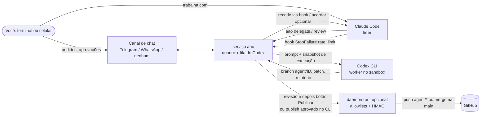

# ai-agents-orchestrator

[](https://github.com/JonasaAugusto/ai-agents-orchestrator/actions/workflows/ci.yml)
[](LICENSE)

[English](README.md)

**Claude Code e OpenAI Codex CLI trabalhando em revezamento, com as assinaturas que você já paga.**

O Claude Code lidera: planeja, conversa com você e revisa. O Codex trabalha como um segundo engenheiro em branches
isolados: pega tarefas delegadas, faz revisão cruzada dos branches do Claude e, quando o Claude atinge o limite de uso,
assume o bastão e continua até o Claude voltar. Você comanda pelo terminal ou pelo celular: nada é integrado nem
publicado sem a sua aprovação explícita.

- **Sem chaves de API.** Usa os CLIs oficiais `codex` e `claude` com os seus logins.
- **Seguro por padrão.** O Codex roda sem privilégios, no sandbox dele, sem rede, em clones descartáveis; publicar exige um humano.
- **Resultado honesto.** Tarefa cujo relatório diz `partial` ou `blocked` nunca aparece como concluída.
- **Só a biblioteca padrão do Python.** Um extra opcional (WhatsApp). Testado em Python 3.11 e 3.12.

A documentação completa (tabelas de comandos, referência do CLI, configuração, FAQ) está no [README em inglês](README.md);
este arquivo resume o essencial em português.

## Como funciona



1. **Delegação**: o Claude (ou você, pelo chat) cria a tarefa com os arquivos que ela toca. O serviço clona o repo a
   partir de um espelho conferido com o GitHub, num workspace descartável e branch `agent/<id>-<slug>`.
2. **Snapshot de execução**: todo prompt começa com fatos gerados em código (horário, SHA da base de cada repo,
   sandbox/rede/modelo/esforço reais, idade do briefing). Espelho que não prova estar atualizado bloqueia a tarefa.
3. **Entrega honesta**: o serviço (nunca o Codex) faz o commit, tira notas soltas do commit, sinaliza remoções grandes
   em documentos e testes que dependem de tempo, e lê a primeira linha do relatório: `Status: completed | partial | blocked`.
4. **Revisão e publicação**: o Claude revisa; publicar (merge `--no-ff` na base) só com aprovação humana: botão
   [Publish] ou `aao publish <id> --approved-by-owner`. Deploy em produção é um segundo botão, separado.
5. **Passagem de bastão no limite**: quando o Claude Code atinge o limite, um hook chama `aao claude-limit`; o Codex
   confere o briefing vivo contra a cauda mascarada do transcript e continua nos próprios branches.

## Modelo de segurança (padrões)

Codex como usuário sem privilégio (`aao`), `workspace-write` **sem rede**; `danger-full-access` só com
`codex.full_access = true` (opt-in explícito, com aviso); publicar sempre exige humano; nada vai ao GitHub fora de
`publish.push_allowlist` (vazio por padrão); token e chave HMAC num arquivo 0600 do root; um único dono no chat;
daemon root opcional e restrito; acordar a sessão do Claude desligado (experimental); segredos de desenvolvimento
mascarados por padrão. Veja [SECURITY.md](SECURITY.md).

## Início rápido

```bash
sudo useradd --system --home-dir /var/lib/ai-agents-orchestrator --create-home --shell /usr/sbin/nologin aao
sudo python3 -m venv /opt/ai-agents-orchestrator
sudo /opt/ai-agents-orchestrator/bin/pip install git+https://github.com/JonasaAugusto/ai-agents-orchestrator   # ainda não está no PyPI
sudo ln -s /opt/ai-agents-orchestrator/bin/aao /usr/local/bin/aao
sudo aao setup      # assistente: canal de chat (Telegram / WhatsApp / nenhum), repositórios, segredos em arquivo 0600
```

No Telegram: fale com o **@BotFather** (`/newbot`) para obter o token e mande qualquer mensagem ao **@userinfobot** para
saber o seu id numérico. Só esse usuário, em chat privado, é atendido.

> **Sem um canal de chat você não consegue mandar pedidos ao Codex pelo celular, receber os avisos dele, nem aprovar a
> publicação com um botão. O Telegram é o canal que permite isso.** O resto funciona pelo CLI e pelo Claude Code
> (delegar, status, revisar, publicar com aprovação explícita no CLI).

Login do Codex, **somente com o comando oficial**, como usuário do serviço:

```bash
sudo -u aao env HOME=/var/lib/ai-agents-orchestrator CODEX_HOME=/var/lib/ai-agents-orchestrator/.codex codex login --device-auth
```

`--device-auth` serve para servidores sem navegador (abra o link e digite o código). O projeto nunca lê, copia nem
imprime arquivos de credencial; confere o login só com `codex login status`. Se o login expirar, a fila pausa e você
recebe este mesmo comando.

```bash
sudo aao doctor     # confere tudo e mostra como corrigir cada problema
sudo cp examples/systemd/*.service /etc/systemd/system/ && sudo systemctl daemon-reload
sudo systemctl enable --now ai-agents-orchestrator.service ai-agents-orchestrator-root.service
aao arm             # liga a passagem de bastão automática (envia a cauda mascarada do transcript à OpenAI)
```

Copie e adapte `rules/BASE_RULES.example.md`, `rules/DIVISION.example.md` e `templates/AGENTS.example.md` para os
caminhos da configuração ([`examples/config.example.toml`](examples/config.example.toml)). Para testar sem conta
nenhuma: `aao serve --dry-run`.

## Plugin do Claude Code

```
/plugin install ai-agents-orchestrator --marketplace JonasaAugusto/ai-agents-orchestrator
```

Instala a skill `orchestrator-workflow` (quando delegar, escrever a tarefa num arquivo e passar `"$(cat arquivo)"`
porque crases no texto são executadas pelo shell, esperar o aviso em vez de ficar consultando, protocolo de revisão,
parcial/bloqueada não é pronto, publicar só após revisão e aprovação humana, briefing de no máximo 40 linhas, nada de
segredos, serializar tarefas que tocam os mesmos arquivos), os hooks (`StopFailure` → `aao claude-limit`;
`UserPromptSubmit`/`SessionStart` → `aao hook-prompt`) e os comandos `/delegate`, `/orchestrator-status`,
`/review-task <id>` e `/codex [id]`. O complemento **experimental** `aao-codex-pane` adiciona `/codex-pane`, um painel
lateral ao vivo (API em acesso antecipado do Claude Code, pode mudar):
`/plugin install aao-codex-pane --marketplace JonasaAugusto/ai-agents-orchestrator`.

## Ver o Codex ao vivo

`aao watch [id]` mostra tarefa, repo, branch e workspace, os eventos (comandos, arquivos editados, mensagens) e segue
até a tarefa terminar, com o diff até o momento; `--no-follow` imprime e sai. `aao watch-open [id]` abre isso num
split do tmux, numa janela nova de terminal, ou imprime o comando. No Claude Code: `/codex [id]`, `/codex-pane [id]`,
ou peça em linguagem natural: *"abre o codex"*, *"mostra o que o codex está fazendo"*. É somente leitura. Exemplo
(ilustrativo):

```
== Codex on task #12: Validar e-mails do cadastro [in progress]
   repo: web-app  branch: agent/12-validar-e-mails-do-cadastro
[14:02:15] $ python -m pytest -q tests/test_signup.py
[14:02:19]   -> exit 1: 1 failed, 4 passed
[14:03:02] edit: update app/signup.py, add tests/test_signup_email.py
[14:03:55] codex: Status: completed ...
== task #12 is in review
```

## Canais de chat

`service.channel = "telegram" | "whatsapp" | "none"`. A lógica do bot é independente do canal (interface em `canal.py`).

**WhatsApp (não oficial, por sua conta e risco)**: substitui o Telegram por completo (pedidos ao Codex, avisos,
aprovações por resposta numerada "1. Publish / 2. Review first", comandos).

> ⚠️ **AVISO:** usa um cliente **não oficial** do WhatsApp Web (pacote opcional `neonize`). **Não tem vínculo com o
> WhatsApp nem com a Meta**, **pode violar os Termos de Serviço do WhatsApp** e **o número pode ser restringido ou
> banido**. Use um **número secundário**, **por sua conta e risco**; o projeto **não dá garantia**. Só funciona com
> `whatsapp.accept_unofficial_risk = true`, e o `aao setup` pede que você digite `I ACCEPT THE RISK`.

Proteções: fala só com `whatsapp.owner_number` (ignora outros números e grupos), destino fixo, sem envio em massa
(limite por minuto e intervalo mínimo), reconexão com backoff exponencial que para de vez em logout ou banimento
temporário, sessão em `<state_dir>/whatsapp` (0700/0600), fora de qualquer repositório e no `.gitignore`. O
pareamento é feito no `aao setup`, com código de pareamento ou QR code no terminal.

## Limitações e roteiro

Limitações: Linux/systemd; formato da mensagem de limite do Codex não é documentado; mascaramento por padrões; acordar
o Claude e o painel dependem de interfaces não documentadas/em acesso antecipado; o canal WhatsApp foi testado só com
dublês, não com uma conta real; um dono por instalação.

Roteiro: canal oficial **WhatsApp Business Cloud API** (Meta), em Python, atrás da mesma interface (exige webhook HTTPS
público e um app empresarial da Meta; limitações: preço por conversa e a janela de 24 h de atendimento); outros canais
(Slack, Matrix, e-mail); identificadores internos em inglês com migração; imagem de contêiner.

## Glossário

`tarefa` task, `quadro` board, `dono` owner, `origem` origin, `estado` state (`pendente`, `em_andamento`, `em_revisao`,
`concluida`, `bloqueada`, `cancelada`), `espelho` mirror, `recado` note.

## Licença

[MIT](LICENSE) © 2026 Jonas Augusto. Sem vínculo com Anthropic, OpenAI, Telegram, WhatsApp ou Meta.
